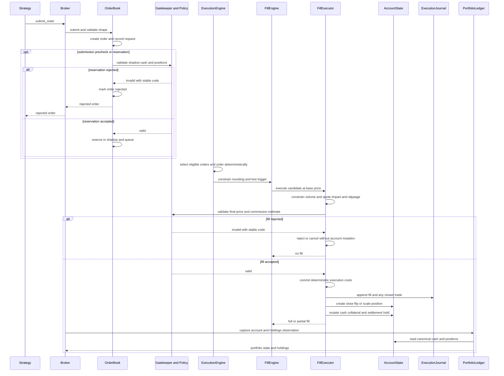

# Broker, Order Execution, and Accounting

`Broker` is the public trading facade, but it is not a second ledger layered over the execution system. It constructs and wires the canonical mutable state—`AccountState`, `MarketState`, `OrderState`, `RiskState`, and `ExecutionJournal`—then gives focused collaborators references to those same objects. In particular, `Broker.cash` delegates directly to `AccountState.cash`; positions live in `AccountState.positions`; order lifecycle collections live in `OrderState`; and fills and closed trades live in `ExecutionJournal`. This ownership arrangement prevents facade and executor state from drifting.

The main collaborators are:

- `OrderBook`: validates request shape, creates and records `Order` objects, runs optional submission-time prechecks or buying-power reservation, and queues eligible orders.
- `ExecutionEngine`: selects eligible pending orders and applies the configured deterministic ordering policy.
- `FillEngine`: chooses the configured source price, evaluates market, limit, stop, stop-limit, and trailing-stop conditions, and performs affordability sizing.
- `Gatekeeper` plus `AccountPolicy`: perform read-only account validation for entries, additions, and reversals.
- `FillExecutor`: constrains quantity, computes impact, slippage, and commission, rechecks affordability at the final execution price, and commits fills, positions, cash, settlement holds, and journals.
- `PortfolioLedger`: derives account and holdings observations from the canonical account and market state.

This page concerns the broker-owned execution boundary. Runtime phase scheduling is described in [Event-Driven Runtime](event-driven-runtime.md), while portfolio controls and forced exits are covered by [Risk Controls and Rebalancing](risk-controls-and-rebalancing.md). Profile-driven choices such as execution mode, ordering, costs, and account behavior are introduced in [Configuration and Profiles](../concepts/configuration-and-profiles.md).

## End-to-end order path

*The sequence shows both rejection branches and the accepted path from submission through reservation, deterministic selection, constraints, final pricing, account mutation, journaling, and portfolio capture.*

Submission validation and fill mutation are deliberately separate. Validation may inspect the account or a shadow copy and quote costs, but it must not mutate cash, positions, or a stateful cost model. Only the accepted execution path commits economic state. A rejected order remains in the all-orders history with its reason and stable rejection code, but has no fill and does not change portfolio cash or positions. In that accounting sense rejection is atomic. This distinction also makes “no orders” observably different from “all orders rejected” in results.

## Submission, prechecks, and reservation

`OrderBook.submit_order()` first validates finite quantity and required positive limit or stop prices. It derives the side when omitted, applies trading controls and scheduling eligibility, creates a stable `ORD-N` identifier, captures the signal price, and appends the order to the all-orders collection before later rejection or queueing. Converted instruments, quantity rounding, missing prices, and failed fill checks can therefore produce explicit rejected order records rather than disappearing.

There are several intentionally different submission modes:

1. **Immediate same-bar market fill** validates against the real account and proceeds directly to execution.
2. **Next-bar submission precheck** simulates queued orders at the signal price. Its Backtrader-compatible mode retains shadow effects even from a rejected request because it models sequential submitted-queue pseudo-execution.
3. **Buying-power reservation** models LEAN-style reservation. Only an accepted request commits shadow cash and positions; a rejected request does not consume the reservation pool.
4. **No submission check** simply queues the order for fill-time validation.

The shadow pools are advisory or reservational state, not the canonical portfolio. Margin-aware reservation delegates to the same policy methods used by fill-time validation. This shared policy boundary is important: adding an account type or margin convention should not create a separate submission-only accounting implementation.

## Eligibility and deterministic ordering

`ExecutionEngine` filters a copy of pending orders by:

- explicit `_eligible_from` time and boundary semantics;
- open-phase exclusion of market-on-close orders;
- optional order type and order-ID scopes; and
- next-bar exclusion of orders submitted in the current bar unless explicitly included.

It then applies `fill_ordering`: `exit_first`, `sequential`, `priority`, or FIFO fallback. `exit_first` processes capital-releasing exits before entries, but reclassifies each exit at fill time because an earlier order for the same asset may already have exhausted the position. `sequential` preserves submission order and marks after each fill. Priority ordering can preserve submission order or sort by configured free-cash or notional conventions. Stable Python sorting preserves submission order for equal keys.

Ordering is accounting behavior, not a presentation detail: it determines which order sees released cash, updated positions, and fresh marks. New execution paths must use the common `ExecutionEngine` ordering rather than iterating an unordered mapping or independently sorting. Likewise, shadow validation and real execution must preserve the same queue sequence when reservation is intended to stand in for fill-time validation.

## Trigger checks, quantity constraints, and pricing

`FillEngine` resolves the source price from order intent and configuration. Market-on-close uses the close; next-bar orders normally use the open unless a quote-side, quote-mid, bid, ask, or VWAP source is explicitly selected; child intents executing at the open also use the open. Conditional order behavior is selected by `ConditionalOrderMode`:

- market orders use the source price, subject to risk-exit stop slippage;
- limit orders require the configured execution price or OHLC range to cross the limit;
- stops become triggered when the execution price or bar range crosses the stop and use the open on a gap through;
- stop-limit orders require both stop activation and limit eligibility;
- trailing stops update their stop from the bar high or low before testing it.

After trigger eligibility, `FillExecutor` applies execution limits such as available quote size or shared per-bar volume capacity. Integer shares are rounded down. A nonzero remainder stays attached to the order for later bars, while cumulative filled quantity and volume-weighted average fill price remain on the original order.

Pricing follows one shared adverse-cost convention: market impact adjusts the base price, then slippage is added for buys and subtracted for sells. Impact must be finite and directionally adverse; the final execution price must be finite and positive. Limit and stop-limit orders are checked again against the cost-adjusted price, so modeled costs cannot silently violate the limit.

Cost quoting is also deterministic. Built-in stateless commissions can be calculated directly for validation; custom mutable models are deep-copied for estimates. Mutable impact and slippage models are similarly quoted through independent copies, and the actual committed model must reproduce the quote. This prevents an order that is later rejected—or a binary search for an affordable partial quantity—from consuming model state. The actual commission is calculated once on the accepted fill.

## Account validation without mutation

`Gatekeeper.validate_order_with_code()` classifies the signed quantity change against the current position:

- a pure reduction or close is accepted because it releases capital;
- a reversal delegates to `AccountPolicy.handle_reversal()` because it closes one side and opens the opposite side;
- a new position delegates to `validate_new_position()`;
- an addition delegates to `validate_position_change()`.

Commission is included in the available-cash input. Spendable cash may also subtract settlement holds and a configured cash buffer. For non-levered `lock_notional` short accounting, validation uses the dedicated free-cash and short-basis ledgers instead of treating short-sale proceeds as freely spendable cash.

`UnifiedAccountPolicy` parameterizes three broad account behaviors:

| Behavior | Shorts | Leverage | Validation basis |
| --- | --- | --- | --- |
| Cash | no | no | spendable cash including costs |
| Short-enabled non-levered | yes | no | cash plus configured short-proceeds collateral convention |
| Margin | yes | yes | net liquidating value less initial-margin requirements |

Margin requirements may be account-wide percentages, per-asset percentage-of-notional schedules, or fixed per-contract schedules. Maintenance requirements are separate from entry validation and feed margin-call and portfolio-accounting views.

Rejection codes are independent of display text: account restrictions, insufficient cash, and insufficient buying power are classified structurally. Callers and artifact readers should rely on `rejection_code`, not parse the human-readable reason.

## Final affordability and the mutation boundary

A base price can be affordable while the actual fill is not. After volume sizing and cost pricing, `FillExecutor` revalidates the candidate quantity at the final impact- and slippage-adjusted price. If configured, it binary-searches the largest affordable integer or fractional quantity and then reprices that smaller quantity, because quantity-dependent impact can change. Otherwise it rejects the order (or cancels it in explicitly permissive mode) before appending a fill or mutating the account.

This final check is a core invariant: a non-levered validated account cannot be pushed into debt merely by slippage, impact, multiplier scaling, or commission. `skip_cash_validation` and leverage are explicit exceptions, not accidental bypasses.

Once accepted, one `FillExecutor.execute()` call owns the commit order:

1. append the `Fill` with source-price and quote context;
2. update cumulative order fill state;
3. create, close, flip, or scale the position;
4. allocate commission between close and open legs when flipping and record realized `Trade` entries for full or partial exits;
5. update locked-notional free cash and short basis when configured;
6. debit or credit cash using `-signed_qty * fill_price * multiplier - commission`, or apply the declared futures variation-settlement method;
7. sync the position mark to the execution price for same-cycle buying-power checks;
8. add a settlement hold for positive proceeds when settlement delay is enabled; and
9. optionally capture an after-fill portfolio snapshot.

The order of these operations and the sign/multiplier conventions must remain shared across normal execution, partial fills, submission shadows, and next-bar queue shadows. A locally “equivalent” formula applied in a different order can change floating-point cancellation, reversal collateral, commission allocation, or the buying power visible to the next order.

## Position lifecycle and accounting

A fill from flat creates a `Position` with signed quantity, execution entry price, multiplier, accumulated entry commission and slippage, and configured high/low-water-mark context. Scaling up uses a quantity-weighted average entry price and accumulates entry costs. Scaling down realizes a proportional trade, allocates the corresponding share of entry commission to it, and leaves the residual cost on the remaining position. Closing removes the position and records a trade net of entry and exit commissions. Flipping records the close trade, splits commission proportionally between close and open legs, installs a new opposite position at the fill price, and cancels competing pending orders for that asset.

Ordinary instruments use notional cash accounting. Futures configured for variation accounting instead post realized variation payouts and retain a variation basis; their portfolio liquidation value is quantity times the difference between mark and variation basis times multiplier. Settlement holds track positive proceeds separately so policy can decide whether unsettled cash reduces buying power.

## Portfolio capture and public results

`PortfolioLedger` is a read model over canonical state. It selects each mark using the configured mark source, then falls back through last observed price, `Position.current_price`, and entry price. A snapshot returns equity, cash, gross exposure, net exposure, position count, and optional per-holding rows. Corporate-action receivables are included in equity. Futures snapshots additionally expose liquidation value, unsettled variation PnL, initial and maintenance margin, available funds, settlement holds, cash buffer, and margin-breach status.

Broker observation methods capture bar-level or after-fill snapshots into `ExecutionJournal`; they do not create another mutable account. The result layer can therefore expose fills, trades, rejected orders, holdings, and portfolio state from one reconciled history. See [Results, Analytics, and Artifacts](../workflows/results-analytics-and-artifacts.md) for artifact formats and downstream use.

## Safe extension points and invariants

When changing this subsystem:

- add account behavior behind `AccountPolicy` and keep validation read-only;
- use `estimate_commission()` or `quote_commission()` for pre-trade decisions and `calculate_commission()` only for the committed fill;
- keep execution-limit and price-model outputs finite, nonnegative where required, and no larger than the requested quantity;
- preserve `Broker` as the owner/wiring boundary and pass canonical state objects into collaborators rather than introducing mirrored lists or balances;
- retain rejected orders in `OrderState.orders`, but never append a fill or mutate portfolio state for a wholly rejected order;
- revalidate at the final cost-adjusted price, including contract multipliers;
- preserve deterministic order iteration, priority tie behavior, and cost operation order across every accounting path; and
- route portfolio reporting through `PortfolioLedger` so mark fallback, receivables, variation accounting, and margin details stay consistent.

Focused regression coverage includes `tests/contracts/test_broker_state_ownership.py` for collaborator ownership and mutation scope, `tests/contracts/test_execution_contracts.py` for same-bar/next-bar and quote-side price contracts, `tests/test_final_execution_affordability.py` for final-price rejection, partial sizing, and stateful model isolation, and `tests/test_rejected_order_results.py` for structured rejection persistence and reconciliation.
