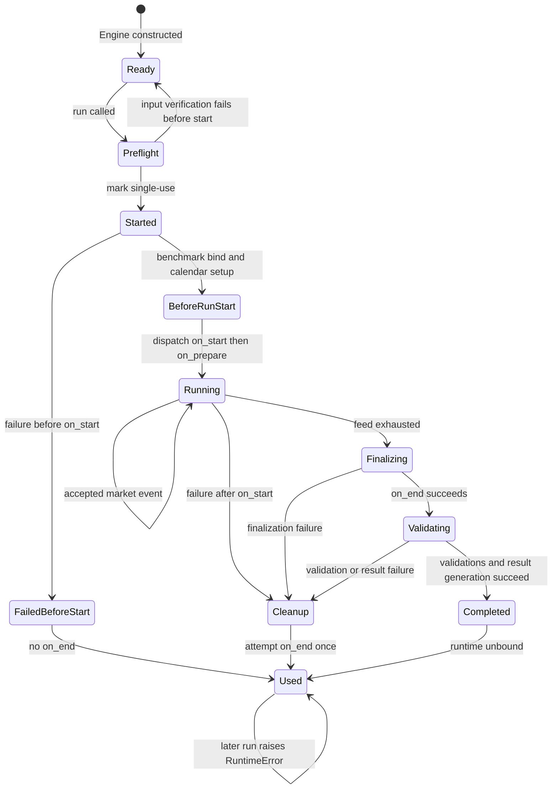
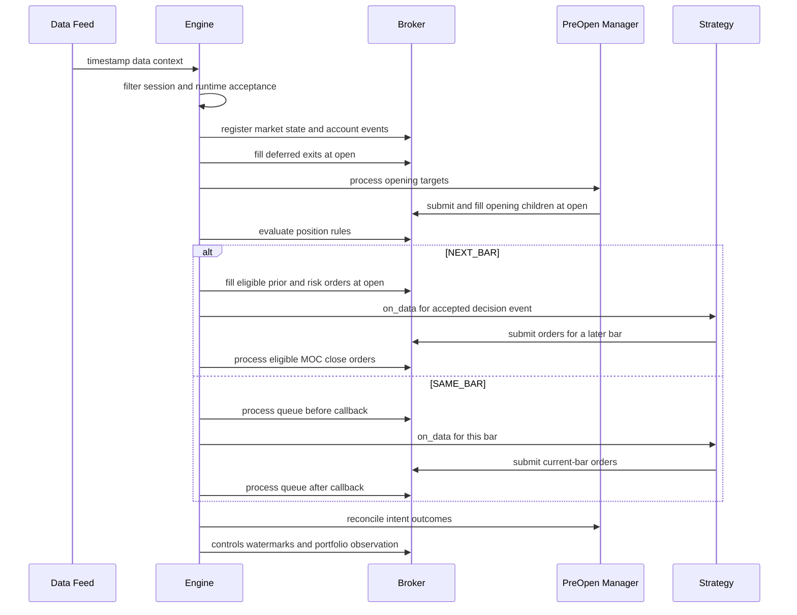

# Event-Driven Runtime and Strategy Lifecycle

`Engine` is the orchestration boundary for one backtest. It combines a `DataFeed`, a user `Strategy`, a copied and feed-resolved `BacktestConfig`, a newly constructed `Broker`, lifecycle dispatch, pre-open target management, optional runtime services, calendar/session filtering, account events, portfolio observations, and final result construction. The broker remains the execution and accounting owner; see [Broker Execution and Accounting](broker-execution-and-accounting.md). Optional scheduler and data-masking behavior belongs to [Runtime Services](runtime-services.md).

The central design constraint is **causality**: strategy code may act only at its declared lifecycle boundary, using information available by that boundary. In particular, `on_prepare` receives the resolved configuration but not the feed's future timestamp sequence, and an order derived from a completed close cannot fill at that same timestamp under `NEXT_BAR` execution.

## One Engine, one run

An `Engine` instance is single-use. `run()` rejects a second call once a run has started, regardless of whether the first started run succeeded or failed. Create a new `Engine` for every run rather than trying to reset its broker, callback counts, intent manager, or observations.

Before marking the run as started, `run()` may verify feed integrity. After that boundary it validates benchmark coverage, binds optional `RuntimeServices`, and delegates to `_run_once()`. The runtime is always unbound in a `finally` block. A normal run finalizes the strategy, validates strategy, broker, and lifecycle invariants, then generates a `BacktestResult`.

*The run becomes permanently used after the start guard; `on_end` cleanup is conditional on `on_start` having been dispatched.*

### Failure and `on_end` semantics

`on_end` is an exactly-once boundary for a run that reached `on_start`, not merely a success callback:

- Normal exhaustion calls `on_end` before completed-run validation and result generation.
- A strategy callback failure or a later engine failure triggers cleanup that attempts `on_end` once.
- A failure before `on_start` does **not** call `on_end`.
- If cleanup `on_end` also fails, the original failure remains the raised exception and receives a note describing the finalization failure.
- `_strategy_finalized` is set before dispatch, preventing a failing `on_end` from being invoked again.

Lifecycle dispatch is transactional with respect to broker mutations made through supported broker APIs. A callback's broker state is captured lazily on first mutation; if the callback raises, the dispatcher restores the captured state and re-raises. Read-only callbacks incur no snapshot. This rollback boundary covers such behavior as newly submitted or immediately filled orders and updates or cancellation of pending orders. It is not permission to replace broker-owned collections directly, and corrupting append-only history can make safe rollback impossible.

## Strategy callback contract

The versioned lifecycle maps to the base `Strategy` methods in this order:

1. `RUN_START` → `on_start(broker)`: the broker is configured, but no market bar is registered. Use it for price-independent setup.
2. `CAUSAL_INITIALIZATION` → `on_prepare(broker, config)`: receives the engine's resolved config, still without future feed data.
3. `MARKET_EVENT` → `on_data(timestamp, data, context, broker)`: dispatched once for each accepted decision event, not necessarily once for each raw feed timestamp in session mode.
4. `RUN_END` → `on_end(broker)`: finalization after the final accepted bar, or cleanup after a post-start failure.

The engine rejects historical callback shapes that violate these boundaries before broker creation: an `on_before_risk` override has no supported strategy phase, and an `on_prepare` signature exposing `timestamps` would reveal future feed structure. The dispatcher counts contract callbacks and can optionally retain a full invocation trace when `retain_lifecycle_history` is enabled. Completed-run validation requires exactly one start, prepare, and end callback and a market-event count matching accepted decision events.

## Per-bar pipeline and execution modes

A raw feed item is not automatically a strategy event. Calendar enforcement and optional runtime acceptance happen first. Runtime scheduling advances around the event, account ledgers advance, and context is causally masked before the broker observes the bar. For an accepted bar, the engine then follows this order:

1. Expire eligible session orders at the pre-event boundary.
2. Advance corporate-action and futures ledgers, then register current prices, OHLC, volume, quotes, and signals with the broker.
3. Apply capital and funding events.
4. Fill deferred `NEXT_BAR_OPEN` risk exits at the open.
5. Process eligible pre-open target intents at the opening price.
6. Evaluate position rules, which may produce ordinary or deferred exits.
7. Enter the execution-mode-specific branch described below.
8. Reconcile opening intents, perform post-event expiry and account-control checks, update futures marks and position watermarks, and record portfolio state.
9. Run the scheduler's after-event boundary.

*Representative accepted bar: both modes share opening and risk preparation, but differ in when ordinary strategy orders become fill-eligible.*

### `NEXT_BAR`

Eligible orders already pending when the bar begins are processed at the open before strategy decisions. Orders created by the current `on_data` are normally excluded until a later bar, preserving the close-to-next-open causal boundary. A market-on-close (`MOC`) order is the explicit exception: the engine has a post-callback close-processing pass, subject to session-mode eligibility. Deferred risk exits are processed before opening targets so that target sizing sees the resulting position and released cash.

This ordering matters at end of data: an order submitted on the final event may remain pending because there is no next bar. The engine does not synthesize a fill.

### `SAME_BAR`

The broker processes pending work both before and after `on_data`, so orders created by the callback can execute on the current bar according to broker configuration. Position-rule exits are evaluated before the first processing pass. Broker safeguards prevent re-entry into an asset on the same bar after a stop exit; that guard resets on the next bar.

The engine applies account controls after callbacks and again after fills in both branches. Position watermarks update only after all bar fills, so a newly opened position's entry-bar range affects the watermark used by later trailing-rule evaluation.

## Pre-open target intents

`PreOpenTargetManager` is the causal bridge from canonical portfolio targets to opening-auction child orders. A target is registered without reading feed prices, normally during `on_prepare` for the first session or during a prior market event for a future session. Registration enforces lifecycle version, `PRE_OPEN` effective phase, execution-policy support, idempotency, non-overlap for the same session and asset, rule-policy bindings, and causal timing.

At an eligible opening, the manager:

1. Resolves the current exchange session and rejects missed or late decisions and information cutoffs.
2. Lowers the target against opening account and market state into canonical child intents.
3. Verifies that actual execution limits agree with the declared liquidity and partial-fill policy.
4. Submits only those child market orders and fills them with `use_open=True`.
5. Cancels any opening-auction remainder, requiring every child order to be terminal.
6. Reconciles fills, residual quantities, rejection/cancellation outcomes, and target-managed position rules.

Opening children are isolated from the broker's ordinary queue, and opening execution remains tied to the open even if ordinary execution uses a different price. Counts are always emitted in result contract evidence; full target, child, and reconciliation histories are included only when `retain_intent_history` is enabled. Serialized intent state supports restoring evidence and idempotency only under strict conditions: the manager must be empty, and post-opening order references require matching broker state that a fresh `Engine` does not provide.

## Sessions and decision aggregation

Session identity depends on timestamp semantics, bar labeling, data frequency, configured data timezone, and—when available—the exchange calendar's authoritative timezone and schedule. Daily session labels map directly to their date. Physical event or bar-close timestamps are localized and assigned to exchange sessions; right-labeled closing endpoints belong to the session that just closed. See [Market Data and Time](../concepts/market-data-and-time.md) for the broader timestamp model and [Configuration and Profiles](../concepts/configuration-and-profiles.md) for behavioral settings.

With calendar enforcement, excluded bars never reach broker market-state registration or `on_data`; funding events on excluded timestamps are rejected. The engine also warns when intraday filtering retains suspiciously few bars and an alternative exchange-timezone interpretation explains the loss.

A feed with `session_col` activates cross-sectional session decisions and requires `NEXT_BAR`. The engine accumulates each asset's latest bar and context through the session, dispatches one combined `on_data` at the feed's decision timestamp, then clears the accumulator. Orders fill on each asset's next matching bar rather than pretending that assets with different real closes share one instant. Feed construction rejects missing or duplicate asset/session bars and timestamps mixing different sessions. Session-end cancellation is available only with a declared calendar and physical `event_time` or `bar_close` semantics.

## End of data and result generation

There is deliberately **no automatic end-of-data liquidation**. After the last bar, `on_end` sees the portfolio as it actually stands. Result generation combines broker-closed and partial trades with synthetic mark-to-market `Trade` records for still-open positions. Those records have `status="open"`, `exit_reason="end_of_backtest"`, the last observation time and mark, entry fees only, and no fictional exit slippage. This representation preserves terminal exposure without creating orders, fills, cash movements, or realized exits.

After successful finalization, the engine validates strategy-owned executors, broker invariants, and lifecycle cardinality before constructing the result. The result includes trades, fills, rejected orders, equity and portfolio observations, funding and capital changes, optional holdings, accounting artifacts, configuration, provenance, recorded variables, activity and performance metrics, and lifecycle/execution-policy evidence. No-data runs still return a structured empty result with configuration and contract evidence.

## Safe extension points

- Implement `Strategy.on_data`; use `on_start`, `on_prepare`, and `on_end` only for their stated causal phases.
- Use broker APIs rather than mutating or replacing broker-owned collections.
- Select `ExecutionMode` based on the intended information-to-fill delay; session decision feeds force `NEXT_BAR`.
- Register pre-open targets through the configured broker/manager contract and declare execution assumptions explicitly when defaults are unsuitable.
- Add temporal scheduling and masked auxiliary data through `RuntimeServices`, while preserving the engine's bind/unbind and event boundaries.
- Treat per-bar ordering as an invariant when changing risk, auctions, controls, or accounting. Moving a step can change available cash, target sizing, fill prices, and whether a decision uses completed-bar information.
