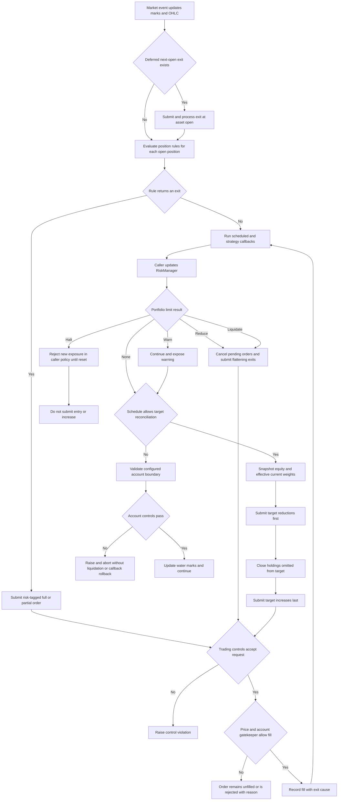

# Risk Controls, Stops, and Rebalancing

Risk management is not one gate. The system has four mechanisms with different owners and lifecycle boundaries, plus target-weight execution that remains subject to those mechanisms:

| Mechanism | Scope and evaluation point | Failure or action | Lifetime and resumption |
|---|---|---|---|
| **Position rules** | `RiskEngine` evaluates each open position against the current bar before strategy callbacks. Per-asset rules override the global rule. | Return `HOLD`, full exit, or partial exit; the broker submits a normal market order now or records a deferred exit. | Rule and position state live with the broker/position. A position disappears when fully closed; a deferred exit survives until an asset open is available. |
| **Portfolio limits** | A caller explicitly initializes and calls `RiskManager.update(...)` with equity and position market values. This is separate from automatic per-bar position-rule evaluation. | Warn, reduce, halt, or liquidate. Reduce and liquidate use broker orders when a broker is supplied. | Halt is sticky until `reset_halt()` or `initialize()`. A reduction is applied once per continuous breach and rearms after that limit clears. Liquidation is applied once until reset/reinitialization. |
| **Trading controls** | Ordered broker validators run before every order submission, including updates and risk-generated orders. They inspect an immutable request and current held/pending exposure. | Raise `TradingControlViolation` before an order ID, submission count, or cash is consumed. Later execution can still reject an accepted order. | Registered on a broker until explicitly unregistered; day/session counters follow their configured civil-day or exchange-session boundary. |
| **Account controls** | Validators inspect the native marked account at `after_callbacks`, `after_fills` (default), or a configured `session_end`; they may also be invoked immediately. | Raise `AccountControlViolation` and abort the run. They neither roll back completed callbacks nor request liquidation. | Registered for the run. Session-end controls must be registered before observations and require a calendar and physical close timestamps. |

This separation is operationally important. A portfolio `halt` means “do not open or increase via code that consults `RiskManager`”; it is not an exception and does not itself cancel orders unless the chosen action is liquidation/reduction. Conversely, an account-control breach is an exception, not a managed halt. See [Broker Execution and Accounting](broker-execution-and-accounting.md) for the order/fill ledger and [Event-Driven Runtime](event-driven-runtime.md) for callback placement.

## End-to-end control flow

*The flow shows automatic position-risk evaluation, explicit portfolio actions, rejection/halt outcomes, and the exits-before-entries ordering used by target reconciliation.*

In `NEXT_BAR` mode, deferred `NEXT_BAR_OPEN` exits are processed first, then new position rules are evaluated and same-cycle risk exits are processed before callbacks. In same-bar mode, the engine likewise evaluates rules before callbacks, but ordinary queued orders are processed around callback execution. Water marks update only after fills at the end of the event, which is why lagged trailing stops use the prior bar's mark.

## Position rules and stop execution

### State supplied to a rule

For each held asset with a usable current price, `RiskEngine` chooses the per-asset rule if present, otherwise the global rule, and builds a `PositionState` containing:

- side, absolute quantity, initial quantity, entry price, P&L, return, and bars held;
- current OHLC and time;
- high/low water marks and favorable/adverse excursion;
- position context, including stop configuration and custom signal inputs; and
- the instrument multiplier.

No current price means no evaluation for that position on that event. `RuleChain` and `AnyOf` return the first non-`HOLD` action in declaration order, so order is priority. `AllOf` requires every child to trigger and returns the first action's shape with combined reasons. Stateful rules such as `ScaledExit` must not be shared across unrelated positions unless deliberately reset.

### Static and trailing exits

`StopLoss` and `TakeProfit` test the intrabar low/high for both long and short positions. Their threshold normally uses the fill price; `StopLevelBasis.SIGNAL_PRICE` uses a recorded signal price when available. Fill behavior is selected by `StopFillMode`:

- `STOP_PRICE` uses the threshold when crossed within the bar and the open when the bar gaps through it;
- `CLOSE_PRICE` uses the current close;
- `BAR_EXTREME` uses the relevant low/high; and
- `NEXT_BAR_OPEN` stores a deferred exit until a later event provides that asset's open.

`TrailingStop` derives a long stop from the high-water mark and a short stop from the low-water mark. `TrailStopTiming.LAGGED` uses the prior bar's water mark; `INTRABAR` includes the current high/low before testing; `VBT_PRO` first tests the lagged level against the bar range, then updates the mark and tests the close. Gap-through still fills at the open. Related rules include `TimeExit`, ATR-driven `VolatilityStop`, profit-sensitive `TighteningTrailingStop`, partial `ScaledExit`, and context-driven `SignalExit`.

A full action submits `-pos.quantity`; a partial action submits the configured fraction in the closing direction. Immediate and deferred paths both attach the human-readable rule reason, the normalized `ExitReason`, and any rule-selected fill price to the order. The fill executor copies these to `Fill.exit_reason` and `Fill.exit_reason_detail`, so a stop, portfolio reduction, or liquidation does not become an anonymous market fill.

Daily bars can make high-before-low ordering unknowable when a rule activates after the open. For that activation bar, `RiskEngine` honors `BarPathPolicy`: evaluate a declared high/low path, reject differing outcomes with `REJECT_AMBIGUOUS`, or choose the more conservative fill. This prevents silently assuming an intrabar path when stop and profit thresholds can both be reached.

## Portfolio limits: managed actions, not broker admission

`RiskManager.initialize()` establishes initial equity, high-water mark, daily baseline, and a clear action state. Each `update()` computes drawdown, daily P&L, position count, gross exposure, and net exposure, then checks every configured `PortfolioLimit`. Optional context supplies data needed by statistical or classified limits—for example `historical_returns`, `asset_sectors`, and `factor_loadings`.

Built-ins cover maximum drawdown, position count, single-position exposure, daily loss, gross/net exposure, VaR/CVaR, beta, sector exposure, and factor exposure. Their `LimitResult` action has distinct semantics:

- `warn`: replace the manager's current warning list and continue;
- `halt`: set sticky `_halted`; callers must consult `can_open_position()` or `can_increase_position()`;
- `liquidate`: mark the manager halted and, once, call `broker.flatten_all_positions(reason)` when a broker is supplied; without a broker it warns rather than pretending liquidation occurred;
- `reduce`: currently has defined built-in policy for drawdown. It requires `reduction_pct` in `(0, 1]`, cancels pending orders, and reduces every position by the largest newly triggered reduction fraction.

Reduction is atomic at the broker lifecycle-state level: quantities are prevalidated and any rejected reduction submission restores the prior positions/order state. It acts once while each limit remains breached; when that result disappears from a later update it is removed from the armed set, permitting a future breach to act again. Liquidation flattening cancels pending orders and submits one risk-tagged close per position. Both routes use normal broker submission and execution rather than mutating holdings directly.

A halt does **not** auto-resume when the metric recovers. `reset_halt()` clears halt reason and the liquidation-applied latch; use it only under an explicit recovery policy. `initialize()` is the full reset for a new run.

## Trading controls versus account controls

### Pre-submission trading controls

`OrderConstraints` can restrict order/position quantity and notional, long-only behavior, blocked assets, a pure restriction callback, and requests per session/day. By default, position limits include same-direction pending quantities. Opposing pending orders do not net away worst-case exposure, and an unfilled buy cannot authorize a short sale. Economic notional includes the contract multiplier; `notional_basis="quoted_units"` opts into raw price-times-quantity.

Validation occurs before constructing the order and therefore before assigning an ID or incrementing normal submission counters. Once accepted, a submitted order counts even if a later cash/buying-power or fill check rejects it. Updating a partially filled pending order validates the new remaining quantity again but does not create another submission. `OrderRequestCount` is deliberately different: it audits requests that reach that particular validator, so a later validator's rejection can still consume its count.

Risk exits and portfolio actions call the same `submit_order()` path, so custom controls can block them. Design controls accordingly: a long-only rule permits a closing sale only while it does not produce a negative worst-case position, while overly broad asset restrictions can prevent liquidation. The execution gatekeeper is a second boundary: accepted orders can still be rejected for unavailable prices, buying power, or account rules.

### Observed-account controls

`AccountConstraints` currently expresses maximum leverage and a deadline-qualified minimum leverage. Custom validators receive an immutable `AccountControlContext` with marked equity, cash, gross/net exposure, and margin/settlement fields. The selected boundary matters:

- `after_callbacks` sees callback effects and immediate fills, but precedes deferred same-bar or market-on-close fills;
- `after_fills` sees all fills for the event and is the default;
- `session_end` runs once at a physical exchange close and therefore requires declared calendar metadata and complete close observations.

These controls observe reality rather than forecast an order. A breach raises and leaves already completed callbacks/fills intact. Use a portfolio limit, not an account control, when the desired response is managed reduction, liquidation, or resumable policy.

## Target-weight reconciliation

`TargetWeightExecutor.execute()` converts `asset -> weight` into order deltas. Negative targets require `allow_short`; weights may be levered, with optional proportional scaling to `max_gross_leverage`. For each target it:

1. optionally cancels pending orders;
2. captures account equity and current weights, optionally including pending-order value;
3. caps each requested weight to `max_single_weight` and applies short policy;
4. skips deltas below `min_weight_change` or `min_trade_value`;
5. computes `shares = equity * weight_delta / (price * multiplier)` and applies fractional, whole-share, or lot rounding; and
6. submits reductions first, closes holdings absent from the target map, then submits increases.

All orders in one call share a lazily allocated `rebalance_id`; target orders also carry priority notional. `max_single_weight` constrains the requested weight before share rounding, not continuously realized exposure. The scalar helpers in `execution/sizing.py` similarly separate value-to-units conversion and signed-delta rounding from order admission and fills.

### Snapshot, incremental, and hybrid modes

- `SNAPSHOT` keeps starting equity and weights for every target and does not force processing between submissions.
- `INCREMENTAL` processes each eligible order and refreshes both equity and current weights before the next target.
- `HYBRID` processes eligible orders but retains the starting sizing basis.

Processing is not a fill guarantee: execution mode, missing data, controls, and gatekeeper checks still decide the outcome. The simpler `Broker.rebalance_to_weights()` also snapshots account value, applies `rebalance_headroom_pct`, and processes sells before buys, but it is not configured by `BacktestConfig.rebalance_mode`.

### Missing and late prices

The two implementations have intentionally visible policies:

- `Broker.rebalance_to_weights()` uses the current price; with `MissingPricePolicy.USE_LAST` it falls back to the last positive price. `SKIP` omits that asset. `LateAssetPolicy.REQUIRE_HISTORY` suppresses targets until `late_asset_min_bars` have been observed.
- `TargetWeightExecutor` requires the current bar's positive `close` for a **new target trade**, otherwise it skips it. When marking an existing position for current weights it falls back through broker source price, last price, position current price, and entry price. Pending-order valuation uses limit price or current close. A holding absent from the target still receives a close order; whether it fills is then an execution-price-policy question.

An omitted target means “close this holding,” not “leave it unchanged.” On asynchronous daily closes, build the target from a complete session decision rather than the assets present at one timestamp, or the executor will intentionally flatten omitted holdings.

## Scheduling contract

`RebalanceSchedule` supports every bar, every session, every *N* sessions, weekly, month-end, and explicit timestamps. `TargetWeightExecutor.should_rebalance()` is an online state machine: call it—or scheduled `execute()`—for every event in chronological order, including warm-up events. Call `validate_completed_run()` after standalone use; an Engine broker registers completion validation automatically. Call `reset()` before reusing an executor or changing schedule-related `RebalanceConfig`; backward timestamps and mid-run configuration mutation raise rather than silently resetting counters.

Session schedules depend on a time contract. Omitted calendar resolves through the feed/default contract; explicit `calendar=None` disables calendar inference. Weekly and month-end require a calendar and fire only on the final scheduled exchange session. Intraday operation needs calendar/timezone/frequency/timestamp semantics, or an explicit `is_session_close` on every event for sessions that do not cross midnight. Required closes that were reached but never observed cause alignment/completeness errors; the scheduler does not move a weekly/month-end action to an earlier bar. Explicit timestamps compare absolute instants, interpreting naive schedule entries in the configured timezone, and reject missing instants inside the observed run window.

## Safe extension and verification

- Implement a position rule as a side-effect-free `evaluate(PositionState) -> PositionAction`; keep per-position mutable state isolated.
- Implement a `PortfolioLimit.check(PortfolioState) -> LimitResult`; define reduction semantics before advertising `action="reduce"`.
- Implement trading/account validators as pure `validate(...)` methods. Do not place orders from them.
- Implement optimizer adapters through `WeightProvider.get_weights(data, broker)` and pass the result to `TargetWeightExecutor`.
- Preserve `SubmitOrderOptions` cause metadata whenever adding a new forced-exit path, and verify both order rejection behavior and fill attribution.

Focused regression suites are [position and portfolio risk tests](../../tests/risk/), [rebalancer and schedule tests](../../tests/execution/), [trading controls](../../tests/test_trading_controls.py), [session account controls](../../tests/test_session_account_controls.py), and [bracket lifecycle tests](../../tests/test_bracket_lifecycle.py). The user-facing operational examples are in [Risk Management](../../docs/user-guide/risk-management.md) and [Rebalancing](../../docs/user-guide/rebalancing.md).
