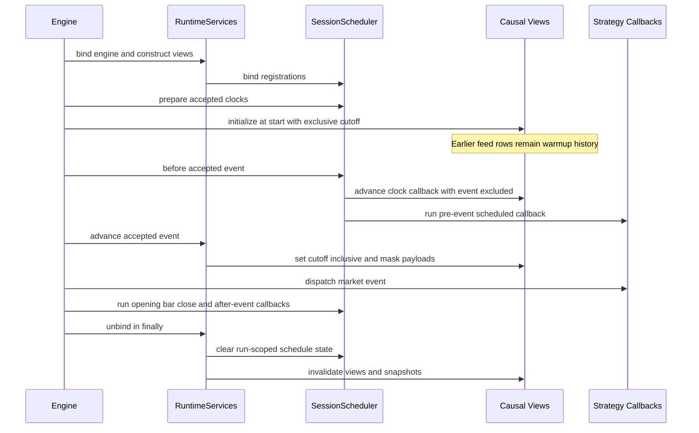

# Causal Runtime Services and Scheduling

`RuntimeServices` is the opt-in, run-scoped boundary between an `Engine` run and data that a strategy may know at a decision instant. It provides market, signal, auxiliary, independent-history, instrument, and scheduler services without adding those objects to strategy state or changing the strategy context. The boundary has two goals: let pre-execution rows serve as causal history, and prevent future, unpublished, ineligible, or stale values from becoming executable observations.

This layer complements the engine flow described in [Event-Driven Runtime](event-driven-runtime.md). The time and identity contracts behind it are covered by [Market Data and Time](../concepts/market-data-and-time.md) and [Instrument and Cash Lifecycles](../concepts/instrument-and-cash-lifecycles.md).

## Run ownership and lifecycle

An `Engine` binds the configured runtime before initialization, executes the run once, and calls `_unbind()` in a `finally` block. Binding accepts only feeds whose timestamp semantics represent physical instants (`event_time` or `bar_close`), constructs the views, validates the configured window and sources, registers trading controls, and binds the scheduler. A runtime cannot be nested into another active run.

All service access is **active-run-only**:

- `market`, `signals`, `assets`, auxiliary views, and prepared-history snapshots validate their owning runtime and current clock;
- a view retained after cleanup cannot be used later, including during a subsequent reuse of the same `RuntimeServices` object;
- `_unbind()` removes the broker high/low reader and instrument/lifecycle controls, closes the instrument view, clears cached history and auxiliary views, and nulls the engine, market, and signal bindings;
- the same cleanup happens after normal completion and exceptions. A partial `_bind()` failure performs equivalent rollback before propagating the error.

See [`RuntimeServices._bind()` and `_unbind()`](../../src/ml4t/backtest/runtime.py#L1018-L1185) and the engine's [`run()` guard and `finally`](../../src/ml4t/backtest/engine.py#L235-L280).

*The sequence shows binding, exclusive warmup/history access, an accepted event becoming inclusive, scheduled callback phases, and guaranteed unbinding.*

## Warmup, execution bounds, and excluded rows

`start` and `end` are inclusive bounds on actual feed event instants. Optional `execution_windows` are ordered, non-overlapping, inclusive physical intervals inside those bounds. At least one feed timestamp must be accepted. Cash capital and funding events outside the accepted window are rejected rather than silently moved.

Rows before `start`, after `end`, or between execution windows are not dispatched as market events. They therefore create no strategy callback, fill opportunity, or account sample. They remain in the immutable source frame, however, so an earlier excluded row can appear in a history query at a later accepted cutoff. This is warmup, not hidden execution. An excluded row later than the current cutoff remains future data and is invisible.

At binding, the market clock starts at declared `start` when one exists, otherwise at the first accepted event, with the cutoff exclusive. This lets `on_start` and pre-event callbacks inspect only observations strictly before that instant. On an accepted event, `_advance()` sets the cutoff to the event and makes it inclusive before strategy delivery. The engine skips rejected events before scheduler, corporate-action, ledger, broker, and strategy processing ([event loop](../../src/ml4t/backtest/engine.py#L506-L545)). Tests demonstrate both warmup without pre-start trading and gaps that remain readable history ([market tests](../../tests/test_runtime_market.py#L33-L62), [window tests](../../tests/test_runtime_event_windows.py#L16-L63)).

## The causal views

### Market data

`runtime.market` wraps the execution price frame. `current()` reads the active instant; `history()` selects earlier instants; `last_observed()`, `last_traded()`, `observation_age()`, `is_stale()`, and `can_trade()` separate provenance, freshness, and execution eligibility.

There is no implicit stale executable quote. By default, a missing current row returns null (or an empty current result at an exclusive clock). `forward_fill=True`, or a per-field mapping, explicitly requests a **read view** and adds `<field>_observed_at` provenance. `max_age` nulls an expired value but retains its real provenance timestamp. Volume and quote sizes cannot be forward-filled because that would invent tradable liquidity. `can_trade()` always examines the unfilled current quote; it requires a finite positive price and can additionally require finite positive observed volume. Likewise, `last_traded()` requires both finite price and actual positive volume, while `is_stale()` only compares age and does not make a quote tradable ([market query and freshness implementation](../../src/ml4t/backtest/runtime.py#L205-L334), [tradeability methods](../../src/ml4t/backtest/runtime.py#L559-L640)).

### Signals and context

`runtime.signals` is a `FeatureDataView` over the feed's prepared signal frame. It shares the market decision clock but deliberately has no quote aliases, so even a feature named `close` cannot mark or fill an asset. Signal fields may have independent `signal_known_at_cols` and Boolean `signal_eligible_cols`. The same masks are applied both to direct service queries and to the signal dictionary delivered to strategy callbacks.

Context has no separate query view: `context_known_at_cols` masks fields in the callback context copy. Invalid signal/context publication declarations fail during binding, before strategy initialization. Feature history is limited to observation-count or elapsed-time windows; calendar grids belong in upstream feature engineering rather than being inferred in this view ([feature and context binding/masking](../../src/ml4t/backtest/runtime.py#L1018-L1128)).

### Auxiliary data

`AuxiliaryData` freezes a caller-prepared, offline frame. It requires aware physical observation and publication timestamps, one stable entity key, a known-at column for every queryable payload field, optional Boolean eligibility columns, and unique observation/entity keys. Construction selects only declared columns, clones the data, and records a content SHA-256 plus preparation metadata. Runtime lookup uses the exact `source_id`; it neither treats that identifier as a URL nor substitutes another source. Only declared payload fields are queryable.

Auxiliary views share the market cutoff and expose `current()`, `history()`, `last_observed()`, currently published `assets`, and copied metadata. `auxiliary_scope()` can temporarily add frozen sources only while inactive and restores the prior registry even on failure. See [`AuxiliaryData`](../../src/ml4t/backtest/auxiliary.py#L15-L129) and [`AuxiliaryDataView`](../../src/ml4t/backtest/runtime.py#L691-L769).

### Independent and prepared history

There are two prepared-history paths:

- `market.history(..., view="prepared")` asks the single `history_provider` for a causal transformation of the execution grid;
- `runtime.history_source(source_id)` asks a named provider for an independently prepared grid. Declared `history_assets` may admit research-only keys, but those rows still never enter the execution feed or replace executable quotes.

A provider receives the **actual decision cutoff** as `as_of`. At an exclusive before-event clock it also receives `observation_before`, requiring observations at the cutoff to be excluded while revisions available exactly at `as_of` remain eligible. The adapter rejects non-causal metadata, a mismatched cutoff, undeclared price basis, future observations or revisions, imputed observations, invalid physical clocks, and undeclared asset keys. Prepared views are cached only for the current `(cutoff, inclusive)` pair and snapshots reject access after that cutoff changes ([prepared-source validation](../../src/ml4t/backtest/_history_source.py#L14-L113)). A same-grid prepared market view must also preserve execution keys, calendar, timestamp role, bar label, anchor, partial-bar policy, and session start.

### Instruments

`runtime.assets` delegates to a caller-owned `InstrumentSource`; it does not infer identity from ticker strings. Every `active()`, `resolve()`, and `is_active()` query passes the current simulation cutoff as `as_of`, validates aware `available_at` facts, and requires stable identity dtype agreement with the price feed. Resolution is checked against dated symbol and exchange facts.

The instrument view is also a broker trading control. It rejects orders without active identity coverage, cancels pending orders that become inactive, and rejects observed quotes for inactive/unknown instruments. `inactive_position_policy="require_flat"` additionally fails if an existing nonzero position loses active coverage; the default `retain_last_mark` permits retaining the position's last eligible mark. Instrument activity and quote availability are separate tests ([`InstrumentView`](../../src/ml4t/backtest/_instruments.py#L39-L248)).

## Availability and eligibility rules

For every requested field, availability is evaluated at the active cutoff:

1. Resolve the field's declared source column and per-field known-at column. Without a declaration, observation time is the publication time.
2. Reject null publication times and values whose publication time is after the cutoff.
3. At an exclusive clock, reject a row observed exactly at the cutoff even if it is published then.
4. If an eligibility column exists, require it to be exactly `True` after publication.
5. For executable market fields, also require the instrument to have been active at the observation instant, using facts known at the current cutoff.

A known, explicitly ineligible row is a barrier to stale filling: the query does not reach behind it for an older value. A future, not-yet-published row is not such a barrier and therefore does not erase earlier known history. `_advance()` applies these checks to quote fields and delivered signals, while `_mask_context()` performs the analogous publication mask for context ([availability checks](../../src/ml4t/backtest/runtime.py#L159-L191), [event masking](../../src/ml4t/backtest/runtime.py#L1129-L1169)).

## History window semantics

`history()` does not silently reinterpret time:

| Unit | Selection |
| --- | --- |
| `observation` | Last `bar_count` observed source instants before/through the cutoff. |
| `elapsed` | Observations in the left-open interval `(asof - duration, asof]`, adjusted for an exclusive cutoff. |
| `session` | All original observed instants in the last `bar_count` declared exchange sessions; no aggregation. |
| `expected_bar` | Last declared grid points, preserving missing bars as null rather than reaching farther back. |

Session and expected-bar windows require a declared calendar. Expected-bar selection additionally requires a complete version-2, session-open-anchored fixed-time grid; it observes breaks, early closes, DST, label direction, and partial-bar policy, and rejects observed off-grid timestamps. Grid selection creates read rows only—it never creates execution events. `session_bars()` is the explicit aggregation API and reports coverage rather than treating missing volume as known zero. The clock algorithms are in [`_history_clock.py`](../../src/ml4t/backtest/_history_clock.py#L24-L203), with representative missing-grid and elapsed-window expectations in [`test_runtime_windows.py`](../../tests/test_runtime_windows.py#L42-L67).

## Scheduling and callback clocks

`runtime.scheduler.register()` accepts registrations before execution and during initialization, preserving registration order. Supported anchors are `bar`, explicit `clock`, `session_open`, and `session_close`, with lifecycle phases restricted to pre-open, opening auction, market event, intrabar, and close. Session anchors require a declared calendar. Offsets are elapsed minutes from the calendar endpoint, not counts of observed bars.

The scheduler computes accepted physical instants during `_prepare()`:

- pre-open and explicit intrabar clock callbacks run before the next market event and set the view to an **exclusive** clock;
- an explicit clock callback has no invented market observation, fill, or account sample;
- opening, bar, and close callbacks require actual price data at the requested instant;
- an absent official close is not replaced by the session's last input bar;
- for right-labelled bars, same-instant pre-close work is deferred until the observation is available;
- `include_start_session` is narrowly limited to pre-open callbacks and may allow that one callback before `start`; it does not broaden market-event execution.

Callbacks execute through the engine's transactional lifecycle dispatcher and scheduled broker clock. Registration after `_prepare()` is rejected. `_unbind()` discards registrations added during that run and clears all computed event/session state, so runtime reuse does not accumulate callbacks ([`SessionScheduler`](../../src/ml4t/backtest/execution/callbacks.py#L31-L360)).

## Offline-only boundary and failure posture

The built-in services perform no network discovery or fetch: market/signals/context come from the feed, auxiliary data is frozen at construction, instruments delegate only to the explicitly supplied source, and source IDs are exact registry keys. There is no implicit symbol registry or fallback dataset. This makes data provenance and reproducibility caller-owned.

`HistoryProvider` and `InstrumentSource` are extension protocols implemented by caller code. The runtime passes causal cutoffs and validates returned data, but it is not a process sandbox and cannot technically prevent an arbitrary implementation from opening a network connection. To preserve the documented no-network execution guarantee, implementations must be offline adapters over already materialized data; perform downloading, symbol resolution, revision selection, and feature engineering before `Engine.run()`. Provider failures or contract violations abort the run rather than degrading to another source.

Operationally, configure all windows, source mappings, eligibility/publication columns, auxiliary sources, instrument metadata, lifecycle policies, and persistent scheduler registrations before a run. Prefer explicit stale reads with provenance and `max_age`; never use them as a proxy for `can_trade()`. Keep physical instants timezone-compatible, because incompatible clocks are rejected rather than coerced ambiguously.
