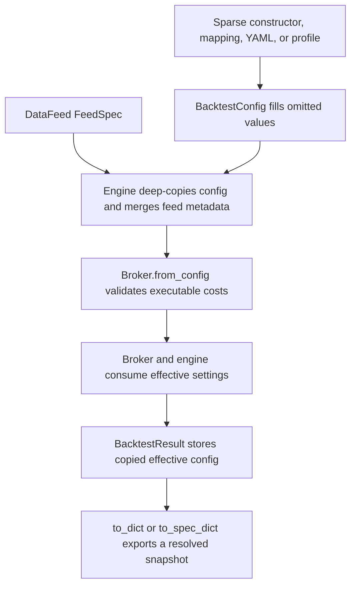

# Configuration, Presets, and Behavioral Semantics

`BacktestConfig` is the serializable behavior contract for a backtest. It controls when and where orders execute, how the account and buying-power checks behave, how costs and stops are modeled, how time metadata is interpreted, and how much diagnostic history is retained. The engine does not use the caller's object directly: it deep-copies the config, merges feed metadata into that copy, builds a `Broker`, and stores another copy of the effective config in `BacktestResult`.

A **profile** is a named bundle of ML4T settings for a documented comparison protocol. Names such as `backtrader`, `vectorbt`, `zipline`, and `lean` do **not** mean “all defaults of that external framework.” They encode the behavior selected for ML4T's bounded, tested workloads. See [Quality, Parity, and Release](../testing/quality-parity-and-release.md) for the evidence boundary.

## Resolution lifecycle

*The configuration progresses from sparse input to an effective runtime contract and finally to result evidence.*

There are three important boundaries:

1. **Sparse input.** A nested mapping or YAML file may omit most sections. `from_dict()` fills absent values from its compatibility defaults and converts strings to enums. Direct Python construction also fills dataclass defaults. One temporal exception matters: new direct constructors default to time contract version 2, while a serialized mapping that omits `calendar.time_contract_version` is interpreted as legacy version 1.
2. **Effective runtime config.** `Engine` deep-copies the config and calls `merge_feed_spec()`. This avoids mutating caller state and lets the actual `DataFeed` supply undeclared schema and time metadata. `Broker.from_config()` then translates the effective fields into account, execution, fee, slippage, settlement, and order-processing components.
3. **Resolved evidence.** Both empty and non-empty runs copy the effective config into `BacktestResult`. `result.config.to_dict()` is therefore the replayable nested configuration with defaults and merged feed declarations present. `result.to_spec_dict()` adds broader run metadata. It is not a complete serialization of arbitrary runtime objects: explicitly supplied `commission_model`, `slippage_model`, market-impact models, execution limits, contract specifications, and similar `run_backtest()` arguments remain separate inputs.

`run_backtest(..., config="vectorbt")` resolves the string through `BacktestConfig.from_preset()` before creating the engine; contract tests require this path to behave like passing the explicitly constructed preset.

## Precedence and merge rules

### Direct configs and `FeedSpec`

Time and schema metadata has deliberately asymmetric precedence:

- Explicit runtime fields such as constructor-supplied `timezone` and `data_frequency` override corresponding feed metadata.
- A `feed_spec` attached to `BacktestConfig` outranks the `DataFeed`'s spec. Under the version-2 contract, fields left undeclared in that config-owned spec can still inherit from the input feed.
- If the config has no `feed_spec`, the data feed supplies it. Inherited timezone and frequency are copied into the effective config unless those fields were explicitly supplied by the caller.
- `calendar` is a selector, not merely a string. In version 2, omission inherits a feed declaration and ultimately uses the `FeedSpec` fallback, while explicit `calendar=None` disables calendar handling. Version 1 preserves legacy null/inheritance behavior.
- `resolved_feed_spec`, `resolved_calendar`, `resolved_timezone`, `resolved_data_frequency`, `resolved_session_start_time`, and `resolved_timestamp_semantics` expose what the runtime will use.

The engine consumes these resolved values for session enforcement, cancellation, pre-open intent handling, annualization, and broker order-session configuration. For the broader timestamp and session model, see [Market Data and Time](market-data-and-time.md).

### Profiles, assumptions, and user files

`get_profile_config()` returns a deep copy, so modifying one loaded profile cannot mutate the registry. `from_preset()` applies that mapping and labels the object with the requested name as provenance; aliases retain their requested label even though their behavior comes from a canonical profile.

`from_assumptions()` currently resolves the normalized tuple `(broker, region, asset_class, plan)` to a preset, recursively merges an optional nested `overrides` mapping, then applies direct dataclass keyword overrides last. The supported broker tuple is currently IBKR, US, stocks, fixed pricing.

`from_user_config()` reads `defaults.yaml` and `assumptions.yaml` from an explicit directory, `$XDG_CONFIG_HOME/ml4t/backtest`, or `~/.config/ml4t/backtest`. With a complete assumptions tuple, effective precedence from lowest to highest is:

1. dataclass/library values for anything still absent;
2. the selected broker/asset-class preset;
3. `defaults.yaml`, except its `commission` section is intentionally excluded because broker assumptions own commission defaults;
4. `assumptions.yaml` overrides under `profiles.<preset>`;
5. the matching `brokers.<broker>.<region>.<asset_class>.<plan>` node;
6. explicit keyword overrides passed to `from_user_config()`.

Without broker assumptions, `defaults.yaml` is the mapping used before explicit keyword overrides. Supplying only part of the four-part assumptions tuple is an error. Nested layers are recursively merged; replacing one leaf does not erase sibling keys.

## Settings by runtime subsystem

### Execution and valuation

`execution_mode` decides whether ordinary market orders are eligible on the decision bar or a later bar. `execution_price` selects the source (`open`, `close`, `price`, `vwap`, midpoint, or quote-aware sources), while `next_bar_execution_price` can change the source for deferred fills without making them same-bar. `mark_price` independently controls open-position valuation. `conditional_order_mode` selects bar-OHLC evidence or the configured execution observation for conditional triggers.

`cancel_policy`, `corporate_action_policy`, and the execution policy determine lifecycle behavior around sessions and actions. Session-end cancellation requires both a resolved calendar and physical `event_time` or `bar_close` timestamp semantics. A VWAP execution configuration is rejected during engine construction if the feed declares no VWAP column; an individual bar lacking VWAP remains an ordinary no-fill condition.

### Account, cash, and settlement

`allow_short_selling` and `allow_leverage` select long-only cash, short-capable non-levered, or margin behavior. Initial and maintenance percentages, fixed-dollar futures margins, and percentage-of-notional schedules feed account checks; the fixed and percentage schedules may not define the same asset. `short_cash_policy` decides whether short proceeds are credited, spendable, or locked as collateral, and `lock_notional_update_mode` controls reversal arithmetic.

`initial_cash`, `cash_buffer_pct`, `settlement_delay`, and `settlement_reduces_buying_power` affect spendable funds. The broker's gatekeeper also consumes `reject_on_insufficient_cash` and `skip_cash_validation`. These choices are behavioral, not reporting-only: they decide whether an entry fills, is partially filled, is rejected, or is silently skipped.

### Order sequencing and sizing

`share_type` and `share_rounding` constrain quantities. `fill_ordering` selects exit-first processing, FIFO submission order, sequential processing, or a single priority-sorted stream. `entry_order_priority` refines ordering under constrained capital. Submission prechecks, simple next-bar checks, queue shadow validation, buying-power reservation, and `immediate_fill` model different points at which eligibility is tested.

`partial_fills_allowed`, volume/execution limits, and available cash jointly determine fill size. `missing_price_policy` and the late-asset fields govern target handling when the current observation or sufficient history is absent. `rebalance_headroom_pct` scales broker helper targets.

Do not confuse the serialized `BacktestConfig.rebalance_mode` profile field with `RebalanceConfig.rebalance_mode`: `TargetWeightExecutor` reads the latter. This separation prevents a profile label from silently selecting the executor's snapshot, incremental, or hybrid sizing algorithm.

### Costs and execution extensions

Commission and slippage sections select built-in models and their parameters. If a model is `none` but a corresponding legacy rate, fixed amount, per-share amount, or spread is positive, `Broker.from_config()` infers the applicable built-in model. An explicit native `commission_model` or `slippage_model` argument takes precedence over the configured model for that run; the object must implement the native protocol.

Cost configuration is validated before the broker is built: rates, amounts, stop slippage, and per-asset spreads must be finite and non-negative. Model outputs are validated again when quoted. Invalid commission, slippage, impact, execution price, or execution-limit output fails before financial state is committed, preserving fail-atomic behavior. See [Broker Execution and Accounting](../architecture/broker-execution-and-accounting.md) for the execution pipeline.

### Stops and risk exits

`stop_level_basis` chooses fill or signal price as the stop anchor. `stop_fill_mode` controls the price used after a trigger. Trailing-stop behavior is further split into the initial water-mark source, subsequent close-versus-bar-extreme updates, optional inclusion of entry-bar extremes, and lagged, intrabar, or two-pass timing. These fields must be considered together; changing only one can alter both trigger time and fill price.

### Calendar and feed interpretation

The config carries the complete serialized `FeedSpec`, including schema columns, bar type, timestamp semantics, session boundary, calendar, timezone, frequency, and bar-grid declarations. `market_data_spec_to_feed_spec()` is the pure bridge from a shared `MarketDataSpec`, while `market_data_spec_to_runtime_metadata()` projects the scheduling subset. `enforce_sessions` makes the engine skip observations outside resolved sessions; calendar-free operation remains available through explicit null under time contract version 2.

### Result capture

Counts are always retained for lifecycle callbacks, target intents, child intents, and reconciliations. `retain_intent_history=True` adds the full intent and reconciliation records; `retain_lifecycle_history=True` adds callback phase, callback name, and event time. These switches trade artifact size for audit detail without changing trading decisions.

## Serialization and validation

`to_dict()` emits stable nested sections: `account`, `execution`, `stops`, `position_sizing`, `commission`, `slippage`, `cash`, `settlement`, `orders`, `calendar`, `feed`, `result`, and `metadata`. Enums become strings, margin tuples become lists, feed metadata uses `FeedSpec.to_dict()`, and user `metadata` is artifact-serialized. `to_yaml()` writes that representation; `from_yaml()` reads it in strict mode.

`from_dict(..., strict=True)` rejects unknown top-level sections and unknown keys, and checks that sections are mappings. This catches spelling errors before a run. `from_user_config()` intentionally parses with `strict=False` after layering, permitting a looser personal configuration boundary. Enum conversion, time-contract construction, corporate-action policy, annualization scale, and session-boundary checks can fail during `BacktestConfig` construction.

`validate()` is advisory: it returns issues and, by default, emits `UserWarning`s. It detects look-ahead risk, zero friction, suspicious cost combinations, malformed margins, settlement ranges, and rebalance constraints, but does not raise merely because issues exist. Execution has a narrower mandatory gate: `Broker.from_config()` calls `_validate_for_execution()` and raises `ValueError` for invalid built-in cost numbers even if `validate()` was never called.

## Profiles are evidence-backed protocols

The core registry exposes `backtrader`, `default`, `lean`, `realistic`, `vectorbt`, and `zipline`; additional strict, OSS, futures, fast, and broker presets remain loadable even when they are not returned by `list_profiles()`. Representative differences include same-bar close and fractional execution for `vectorbt`, next-bar open plus FIFO for `backtrader`, disabled cash validation for the declared `zipline` comparison, and sequential margin-account processing with a per-share commission and target headroom for the frozen LEAN daily-US-equity protocol.

Those values are configuration facts, not universal external-framework claims. The behavior coverage map records each field group, native checks, cross-engine scenarios, publication status, and reasons for exclusions. Consequently, changing a framework-aligned profile creates an evidence obligation:

1. update focused wiring and profile contract tests so the new values demonstrably reach runtime behavior;
2. update native-oracle checks for every affected field group;
3. rerun and update cross-engine scenario or retained parity artifacts wherever the coverage map marks the claim published;
4. narrow or withdraw documentation claims when the changed behavior lacks the required evidence.

A profile edit without this reconciliation can make code, documentation, and retained parity evidence disagree even though ordinary unit tests pass. Treat profile dictionaries as versioned behavioral protocols, not convenient aliases for another project's evolving defaults.

## Practical review checklist

Before relying on or changing a configuration:

- inspect `result.config`, not only the sparse input;
- verify resolved calendar, timezone, frequency, and timestamp semantics;
- distinguish advisory `validate()` findings from construction and execution-time failures;
- record non-config runtime models and contract specifications alongside the config snapshot;
- test interacting order, account, cost, and stop settings at behavioral boundaries;
- for profile changes, consult the behavior coverage map and refresh the corresponding parity evidence.

The end-to-end event lifecycle that consumes these decisions is described in [Event-Driven Runtime](../architecture/event-driven-runtime.md).
