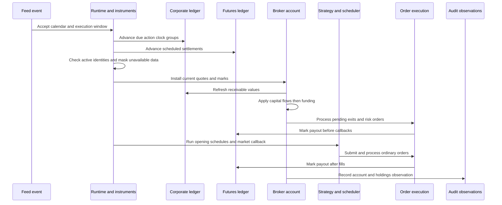
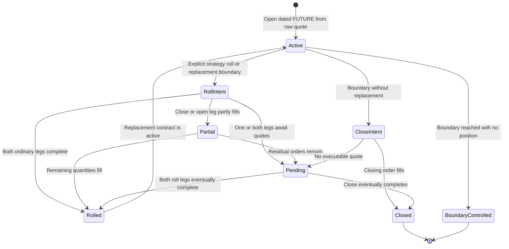

# Instrument, Corporate Action, Futures, Funding, and Capital Lifecycles

These lifecycles change account state without treating the change itself as an order fill. Corporate actions rebase or convert positions and create entitlements; futures settlement moves variation P&L into cash; funding charges the position held at a declared clock; external capital changes the amount invested; instrument lifetime and dated-futures policies determine whether exposure may continue. They all run inside the same account, but retain separate evidence so that cash movement is not confused with execution, investment return, or notional exposure.

This page complements [Broker Execution and Accounting](../architecture/broker-execution-and-accounting.md), which explains ordinary orders and fills, and [Event-Driven Runtime](../architecture/event-driven-runtime.md), which explains callbacks and scheduler phases.

## Inputs are prepared before account mutation

The engine indexes the simple cash schedules at construction time. This is an important failure boundary: malformed funding or capital rows fail before a strategy can trade.

| Input | Required identity and clock | Pre-run constraints | Application basis |
|---|---|---|---|
| Corporate actions | `source`, `event_id`, `revision_id`, `asset`, `action_kind`, `effective_at`, physical `available_at` | A Polars frame and a manifest proving raw price basis; equity and currency declarations must agree; terms, revisions, eligibility and payment clocks are validated and sorted | Position/order state at the action phase; an entitlement freezes the eligible quantity |
| Scheduled futures settlement | `source`, `event_id`, `revision_id`, `asset`, physical `timestamp` and `available_at` | Instrument must declare `futures_variation` with `settlement_policy="scheduled"`; publication cannot follow settlement; currency must match | Position quantity and variation basis held when the event advances |
| Funding | Feed-aligned `timestamp`, feed asset, exactly one of `rate` or `amount_per_unit` | Every timestamp must equal a feed event, each `(timestamp, asset)` is unique, asset is present in the feed, and the numeric term is finite | Quantity held before callbacks/fills; rate uses the causal last mark and multiplier |
| Capital flow | Feed-aligned `timestamp`, globally unique `event_id`, `kind`, finite `value` | `kind` is `delta` or `target`; targets are nonnegative; optional `known_at` cannot be later than the event | Independently marked NAV immediately before the flow |
| Instrument lifetime | Caller-owned causal `InstrumentSource` plus `instrument_feed_spec` | Stable entity column and dtype must match prices; active IDs are unique; aware `available_at` values cannot exceed the current cutoff | Current simulation clock, or an order's earliest eligible execution point |
| Dated-futures boundary | One `FuturesLifecyclePolicy` per old contract with unique event ID | Physical, causal clocks; declared FUTURE specs for old/replacement assets; one of `first_notice`, `last_trade`, `auto_close`, `expiration` | Scheduler callback at the chosen boundary, then ordinary orders and quotes |

Corporate-action construction also resolves civil `date` labels through the configured calendar. With `calendar=None`, every used action clock must be a physical `datetime`. A session label takes effect at UTC session midnight, before premarket callbacks. Funding and capital do not perform this conversion: their timestamp must already be one of the feed clocks.

## Per-event application order

After calendar and runtime-window acceptance, due corporate actions and scheduled settlements advance before the new bar is installed. Runtime instrument checks then reject inactive quotes, enforce the configured inactive-position policy, and cancel pending orders that will no longer be active at their eligible clock. The broker installs the event's quote, refreshes corporate receivables, and only then applies capital and funding. Thus a capital flow values holdings from the current event marks, and a funding rate uses the current mark when the funded asset has one; otherwise it uses that asset's prior causal mark.



*Per accepted feed event, lifecycle cash and identity transitions precede callbacks, while the final mark and account observation follow fills.*

In `NEXT_BAR` mode, pending exits and same-cycle risk orders execute at the open before callbacks; ordinary newly submitted orders normally wait, except MOC processing at the current close. In same-bar mode, ordinary orders are processed both before and after the callback. For `on_mark` futures, the ledger marks before callbacks and again after fills in either mode.

Session and runtime filtering are deliberately strict. A funding event excluded by enforced sessions is rejected rather than silently skipped. The engine later requires every indexed capital event to have produced a change, so a capital event on a filtered calendar observation also fails. `RuntimeServices` rejects capital and funding clocks outside its inclusive `start`/`end` and execution windows. A lifecycle boundary within the eligible feed range but outside an execution window is rejected at binding time.

## Corporate-action state machine

`CorporateActionLedger` requires raw input prices because applying declared actions to already adjusted history would double count economics. It chooses the latest causally published revision for each `(source, event_id)`: an exact duplicate revision is ignored, conflicting duplicate terms fail, tied latest publication clocks are ambiguous, and a revision published after the earliest effective clock cannot rewrite history.

At one action instant, sorting imposes four phases:

1. capture `share_basis="pre_event"` distribution entitlements;
2. apply splits and mergers;
3. capture `share_basis="post_event"` entitlements;
4. pay due obligations.

Within a phase, event identity provides deterministic ordering. The whole same-clock group is atomic: the broker snapshots positions, all pending orders, risk state, asset statistics and target intents, and restores them together with the action journal if any operation fails.

### Splits and conversions

A split uses `split_ratio_convention="new_per_old"`. It rebases position quantity, entry basis, marks and pending order quantities/prices while preserving original requested quantity and original fills. Native `declared_terms` retains fractional shares unless `fractional_policy="cash_in_lieu"`; the legacy `zipline_3_2` policy truncates and uses its compatibility basis rules.

A merger cancels source orders, removes the source position, marks that identity converted so further source orders are rejected, and creates cash/security consideration. Security delivery needs an observed destination mark and the same declared currency—there is no implicit FX. A cash or stock distribution first captures eligibility, so selling the source later does not remove the obligation. Under native accounting, unpaid cash and marked security receivables contribute to NAV but not spendable cash; payment moves cash and/or securities into the account and moves the entitlement to completed history.

The action ledger records each split, order adjustment/cancellation, entitlement, merger and payment. `to_actions_dataframe()` preserves clocks, revision and serialized source terms, quantities, cash, realized P&L and allocated commission. `to_entitlements_dataframe()` preserves earned and paid facts, including delivered security state. Account observations separately retain `receivables_value`.

## Futures variation and settlement

A `ContractSpec(accounting_method="futures_variation")` makes futures principal exposure different from liquidation value. Fills do not exchange full notional through cash. Instead, the position carries a `variation_basis`; unsettled P&L contributes to `positions_value` and NAV until settlement moves it into cash. Margin requirements encumber `available_funds` but are neither fees nor cash deductions.

There are two settlement policies:

- **`scheduled`** — a declared settlement event pays `quantity * (settlement_price - basis) * multiplier`, then moves the basis to the settlement price. At an ordinary reducing fill, only the closed quantity is realized; the remaining position keeps its basis.
- **`on_mark`** — every observed changed mark pays the entire existing position before callbacks, and the post-fill pass pays again after execution when necessary. A fill first settles the previous position to its transaction price, then establishes the resulting position's basis.

The shared `variation_fill` transition is also used by execution and reservation projections, keeping submission checks, buying-power reservations and actual fills on the same basis rule. Settlement events never create executable quotes. Missing marks simply prevent mark-driven transfer, while a declared scheduled price changes cash and basis without entering market history.

`to_futures_settlements_dataframe()` distinguishes `scheduled`, `before_callbacks`, `after_fills`, and fill-linked close/mark transfers from commissions. Portfolio observations expose economic exposure, liquidation value, unsettled P&L, initial and maintenance margin, holds, cash buffer, available funds, and `margin_breach`; a breach is observed evidence, not an invented liquidation.

## Funding and external capital

Funding is a position cash flow, not trading P&L or a fill. For a rate event:

```text
cash_delta = -quantity * mark_price * multiplier * rate
```

For `amount_per_unit`, the mark is omitted from the formula:

```text
cash_delta = -quantity * multiplier * amount_per_unit
```

Positive rates therefore debit longs and credit shorts. A zero position still creates a zero-valued `FundingPayment`, proving that the event was processed. All funding rows at one timestamp are calculated before the total touches cash, so a missing mark or nonfinite result cannot partially apply the group. The funding table retains quantity, mark, multiplier, convention and cash delta.

Capital flows describe money entering or leaving the strategy. `delta` adds its value; `target` computes `value - current NAV`. Every held asset must have a current mark, and the group is validated against cash, NAV, leverage and finiteness before cash is committed. Each `CapitalChange` retains `nav_before`, `cash_delta`, and `nav_after`.

Returns chain the valuation ratio before each external flow with the ratio after it. The external cash itself earns no investment return. This is why funding affects performance while a contribution or withdrawal changes capital without becoming gain. A nonpositive starting valuation is only accepted for the exact zero-to-zero segment; otherwise exact return calculation fails rather than inventing a denominator.

## Instrument identity and lifetime controls

`InstrumentView` is run-scoped: after the owning engine unbinds it, queries fail and caches are cleared. It delegates `lifetimes` and dated-symbol `resolve` to the caller's offline source at the current `as_of`; it never infers identity from a ticker. Returned IDs must match the feed's stable identity dtype, and resolution must agree with the returned symbol and exchange facts.

Identity coverage and tradability are separate. An active identity does not create a quote. Conversely, a quote for an inactive/unknown identity is an error. Before each event, the view can either retain the last eligible mark for an inactive held position or, with `inactive_position_policy="require_flat"`, fail if exposure remains. Pending orders are cancelled when their asset is inactive at the later of now and their eligible execution time. New orders pass the same lifetime check through a broker trading control.

## Dated futures: active contract to roll or expiry

Research selection and executable lifecycle are separate. A prepared continuous series or point-in-time selection may choose the next dated contract, but only raw stable contract IDs are tradable and only `roll_position` submits orders. Adjusted continuous prices and paired roll marks are never execution quotes.



*The lifecycle policy submits ordinary non-atomic orders; a boundary does not synthesize expiry settlement or guarantee completion.*

A policy chooses one upstream-defined physical boundary—Backtest does not derive a liquidation instant from a source date or infer delivery, exercise, exchange settlement, or FX. At the boundary, it cancels pending orders on the old contract and either closes the held quantity or calls `roll_position`. A trading control then allows only reductions after the boundary: increases, reversals, and larger resulting exposure are rejected. If no quote exists, orders remain pending; a boundary after the captured data cannot close exposure.

`roll_position` requires distinct FUTURE contracts in the same currency, no pending orders on either leg, causal decision/publication clocks, and direction-preserving replacement size. The default new quantity equals the old signed quantity, but differing multipliers require explicit `new_quantity`; the broker does not infer a hedge ratio. An unchanged repeated `roll_id` returns the original orders, while conflicting reuse fails.

Submission is atomic only as an **intent**. The close is submitted first and the open only when the close order was accepted, but execution of the two ordinary market orders is non-atomic. Volume limits, missing quotes or controls can therefore leave one leg filled and the other pending/rejected. `to_rolls_dataframe()` projects two ordered rows per intent with actual fill sequences, quantities, commissions, clocks, rejection reasons and a derived state: `no_position`, `completed`, `partial`, `pending`, `not_executed`, or `mismatched`.

## Exported evidence and reconciliation

Portable artifacts do not trust tables merely because they deserialize. Their validators bind lifecycle declarations to observed account and execution evidence:

- corporate-action export verifies source terms against each application, causal clocks, unique entitlements, exactly-once earning/payment, payment cash, finite receivables, and `equity = cash + holdings liquidation value + receivables`;
- futures export verifies instrument method/currency/multiplier, finite account observations, `equity = cash + positions_value + receivables`, available-funds components, margin-breach consistency, and every settlement's quantity/basis arithmetic; fill-linked transfers must identify the actual matching fill;
- roll export verifies two distinct ordered legs, shared intent facts, all actual partial-fill sequences, quantities, fees and clocks, and recomputes completion state from those fills;
- funding artifacts are required when metrics report funding and are checked against event count and total funding; capital-flow rows preserve the valuation bridge used to recompute flow-adjusted returns.

Content digests bind action tables and receivable observations, futures declarations/accounts/settlements, and roll rows. Persisted results therefore distinguish declared source facts, application journals, execution journals, and account observations rather than treating a final NAV as sufficient proof. See [Results, Analytics, and Artifacts](../workflows/results-analytics-and-artifacts.md) for the broader result pipeline.

## Safe extension checklist

When adding another non-order lifecycle:

1. validate and index all causal input before strategy mutation where possible;
2. state whether its clock must match a feed event or may advance between observations;
3. choose its exact position snapshot and order relative to quote installation, callbacks and fills;
4. update cash, free cash, basis and receivables atomically, not just headline NAV;
5. keep source identity and revision terms separate from generated application rows;
6. define behavior under session filtering and runtime execution windows;
7. export enough evidence to recompute every cash delta and cross-link any referenced fill;
8. test long, short, flat, missing-mark, duplicate/revision, partial-execution, filtered-clock, rollback and artifact-tampering cases.
