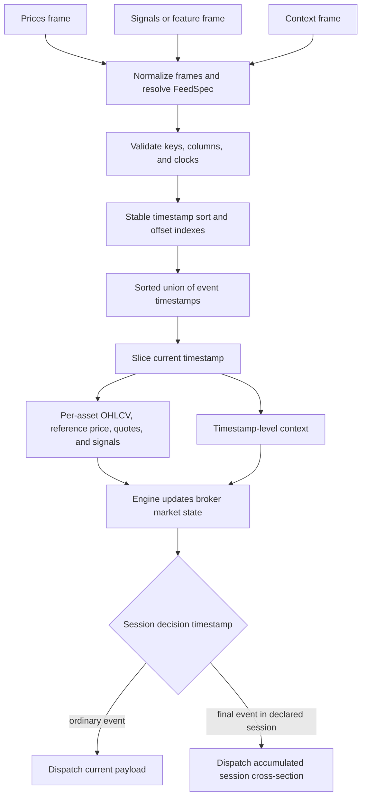

# Market Data, Feed Contracts, and Time Semantics

`DataFeed` is the boundary between tabular input and the event-driven backtest. It does not merely iterate rows: it resolves the input contract, preserves timestamp identity, validates event keys, builds compact timestamp indexes, and emits the price, signal, quote, and context state for one exact event time. `Engine` then updates broker market state before dispatching strategy callbacks. See [Event-Driven Runtime](../architecture/event-driven-runtime.md) for the wider run loop and [Runtime Services](../architecture/runtime-services.md) for causal history access.

The central modeling rule is that **a physical event instant and a trading-session label are different kinds of time**. A timestamp such as `2025-01-02 21:00:00+00:00` can identify an actual close or observation. A label such as `2025-01-02 00:00:00` can instead name the exchange session without claiming that anything happened at midnight. `FeedSpec.timestamp_semantics`, together with the calendar, timezone, frequency, and bar label, tells the engine which interpretation is intended. Precision alone cannot infer that meaning.

## Input contract and normalization

A feed requires a prices panel, supplied through exactly one of `prices_df` or `prices_path`. Signals and context are optional and follow the same mutually exclusive DataFrame/path rule. Parquet paths are collected as Polars frames. Direct inputs may be eager or lazy Polars frames, or Pandas frames; a lazy frame is synchronously collected. Pandas conversion preserves datetime timezone and millisecond, microsecond, or nanosecond unit, preserves nulls, and rejects ambiguous nontrivial indexes or duplicate/non-string columns rather than silently inventing keys ([`_frame_inputs.py`](../../src/ml4t/backtest/_frame_inputs.py)).

`FeedSpec` is the schema and clock declaration. It identifies:

- the timestamp and stable entity columns;
- the reference price and optional `open`, `high`, `low`, `close`, `volume`, and `vwap` columns;
- optional `bid`, `ask`, `mid`, `bid_size`, and `ask_size` quote columns;
- calendar, timezone, data frequency, timestamp semantics, and bar labeling metadata.

`DataFeed` accepts `feed_spec` (with `contract` retained as an alternative name), then applies explicit constructor column overrides and resolves the result against the price columns. Passing both `feed_spec` and `contract` is an error. If no metadata is supplied, the feed constructs a version-2 time contract. The entity column can be explicit or auto-detected in the order `symbol`, `asset`, `product`, `ticker`; failure to resolve one is fatal. Engine configuration subsequently merges the resolved feed contract, with explicit configuration choices taking precedence; this is why an explicit `calendar=None` can deliberately disable calendar enforcement while omission can inherit feed metadata. Configuration precedence is detailed in [Configuration and Profiles](configuration-and-profiles.md).

### Required keys and payload fields

Every price row needs a non-null timestamp and entity. Signal rows need those same resolved keys, while context rows need a non-null timestamp. Price `(timestamp, entity)` and signal `(timestamp, entity)` combinations must be unique; context timestamps may have more than one row in the basic feed, but only the first row contributes to the event payload. Runtime context publication declarations are stricter and require unique context timestamps.

The configured reference `price_col` is required when explicitly selected. Under the default contract, if it is absent but the configured close exists, the close is adopted as the resolved reference price. Construction fails if neither can price the feed. On each price row:

- absent or null `open`, `high`, and `low` fall back to the configured close;
- absent or null volume becomes `0.0`;
- a null reference price falls back to close;
- explicit `mid` is used when present, otherwise both bid and ask can derive `(bid + ask) / 2`;
- **VWAP does not fall back to close**—a missing bar VWAP remains unavailable.

These are configured data-shape fallbacks, not reconstructions of liquidity or an intrabar path. In particular, VWAP execution without a declared `FeedSpec.vwap_col` fails when the engine is created; a declared column with no value on one bar is instead an ordinary unpriceable bar and leaves the order unfilled.

## From frames to broker market state

At construction, each normalized frame is stably sorted by timestamp when needed. The feed stores one frame plus a mapping from timestamp to `(offset, length)`, rather than materializing one DataFrame or Python object graph per event. Its event clock is the sorted union of price, signal, and context timestamps. Iteration performs an indexed slice lookup and converts only the current slices to dictionaries.

*The feed normalizes and indexes tabular inputs, lazily creates per-event payloads, and the engine marks broker state before an ordinary or session-level strategy decision.*

For a price timestamp, the asset payload contains `price`, OHLC, volume, an initially empty `signals` mapping, and any available VWAP or quote fields. Signals at that exact timestamp are attached only to assets that also have a price row in that event. Context is a separate timestamp-level dictionary. A signal-only or context-only timestamp therefore remains part of ordinary feed iteration but produces an empty asset mapping; it does not synthesize a price.

`_AssetsData` also carries pre-extracted caches for price, OHLCV, VWAP, quotes, sizes, and signals. `Engine` passes these views to `Broker._update_time` before callbacks, fills, or risk processing use the current market. Generic feed implementations can return ordinary dictionaries; the engine reconstructs equivalent views as a slower compatibility path.

### Broker price and size fallbacks

Execution and marking are selected by `ExecutionPrice`, not by whichever field happens to exist:

| Source | Resolution |
|---|---|
| `PRICE` | reference price, then close |
| `CLOSE` | close, then reference price |
| `OPEN` | open, then reference price |
| `MID` | `(high + low) / 2` when both exist, otherwise reference price/close |
| `VWAP` | VWAP only; no close substitution |
| `BID` / `ASK` | requested quote side, then reference price |
| `QUOTE_MID` | explicit/derived quote midpoint, then reference price |
| `QUOTE_SIDE` | buy at ask and sell at bid; missing side falls back to open for open execution or reference price otherwise |

For quote-aware capacity, buys use ask size and sells use bid size, with bar volume as the fallback. These behaviors make fallbacks explicit and testable while allowing close-only feeds to operate. They should not be mistaken for evidence that a historical quote existed.

## Signals, engineered features, and publication time

A plain Polars signals frame is an exact-event attachment: every non-key column becomes a signal and is presented with the matching price event. Pandas or lazy signal panels require an explicit `feature_spec`, preventing an implicit conversion from discarding the feature artifact's temporal declaration.

An Engineer feature artifact has a stronger contract. [`feature_signals`](../../src/ml4t/backtest/_feature_signals.py) validates its artifact identity/version, schema and definition mappings, distinct feature columns, source `FeedSpec`, price-basis provenance, and explicit columns for:

- observation timestamp;
- stable entity;
- decision timestamp;
- publication or `available_at` timestamp;
- Boolean eligibility.

Decision and publication values must be timezone-aware instants. Decision/entity keys cannot be null or duplicated. The projection rekeys the panel onto the target feed's timestamp/entity names using **decision time as the event timestamp**, while retaining observation time and publication/eligibility fields. It records a mapping from every visible signal field to its publication column and from each feature to its eligibility column.

When feature metadata exists, `Engine` creates `RuntimeServices` automatically. The runtime combines feature-declared visibility mappings with any caller mappings and rejects conflicts. A field is available only when its known-at value is non-null and no later than the runtime `as_of`; an eligibility-controlled feature additionally requires `eligible is True`. At a non-inclusive current price event, ordinary market values at that same timestamp are withheld, while feature signal views use their declared publication clock. This separation prevents a row's observation or decision timestamp from accidentally making a later-published value visible. Incompatible timezones, missing known-at fields, non-datetime publication columns, and mismatched signal/price entity dtypes fail before strategy use.

Context can receive the same protection through `RuntimeServices.context_known_at_cols`. Without such a declaration, basic context remains exact-timestamp callback data. Use publication timestamps whenever an economic release, fundamental value, model output, or revised dataset became knowable after its observation period.

## Timestamp identity and semantics

### Nanoseconds are event identity

Python `datetime` supports only microseconds, so ordinary Polars row conversion could merge distinct nanosecond events. The temporal boundary helpers return `pandas.Timestamp` for `Datetime("ns", ...)`, patch nanosecond fields during row iteration, infer precise result dtypes, and construct result frames from integer epochs where necessary ([`_temporal.py`](../../src/ml4t/backtest/_temporal.py)). Consequently, distinct nanosecond timestamps survive feed indexing, callbacks, causal history, fills, trades, holdings, cash events, and saved-result round trips. Callers that manually convert them to Python `datetime` discard that guarantee.

### Physical instants versus labels

`TimestampSemantics.EVENT_TIME` and `TimestampSemantics.BAR_CLOSE` describe physical instants. `SESSION_LABEL` describes a date-like label. Runtime services that enforce physical causal cutoffs accept only `event_time` or `bar_close`; session labels must first be prepared as real instants. Likewise, session-end cancellation requires a declared physical timestamp semantic.

For calendar enforcement:

- event instants use half-open session intervals `[market_open, market_close)`;
- `bar_close` or right-labeled bars use `(market_open, market_close]`;
- `bar_close` with `bar_label='left'` is contradictory and rejected;
- a closing endpoint immediately before an intraday break is retained for right-labeled bars;
- session labels are checked as exchange trading dates rather than interpreted as wall-clock midnight events.

This endpoint choice is consequential: a NYSE observation at exactly the close is outside an event-time session but is the valid endpoint of a right-labeled closing bar.

## Calendars and session assignment

The calendar layer wraps `pandas_market_calendars`, resolves common aliases, and exposes authoritative opens, closes, exchange timezones, holidays, early closes, and breaks as Polars-oriented data. Yearly session lookups are cached and include a secondary index by exchange-local open date, which is needed for overnight venues.

`filter_to_trading_sessions` first localizes naive timestamps using the declared `naive_tz`, converts them to UTC, expands the schedule range at both ends for overnight sessions, and optionally splits sessions around breaks. An as-of interval join applies the endpoint convention above. Empty schedules return an empty frame. This handles irregular observations without assuming a fixed bar grid.

`session_date_for_timestamp` preserves the distinction between labels and instants:

- explicit session labels, and undeclared daily timestamps in legacy/default cases, use `timestamp.date()`;
- physical timestamps are localized from the data timezone and converted to the exchange timezone;
- authoritative calendar sessions determine labels for overnight and right-labeled endpoints;
- an evening custom boundary assigns observations at or after the boundary to the next calendar day's session;
- morning-start sessions retain the local calendar date, including pre-market observations.

Custom session starts are intentionally constrained. A calendar's standard morning open can be restated, and an evening override is allowed only for an evening-start calendar or where authoritative metadata is unavailable. Unsupported custom morning/evening boundaries fail rather than creating a plausible but wrong session map.

## Cross-asset session decisions

Exact timestamp iteration is correct for market state but can be dangerous for a daily cross-section whose assets close at different times. With no `session_col`, the strategy receives one callback at each physical close and sees only assets present at that timestamp. With a `session_col`, `DataFeed` treats each supplied Polars `Date` as a session membership declaration and records the final physical timestamp in each session as its decision timestamp.

Session mode validates the complete panel up front:

- every union-clock timestamp must have a price row, so signal-only/context-only events are forbidden;
- one timestamp cannot mix session dates;
- session dates cannot go backward as physical timestamps increase;
- each asset appears once per session;
- every session contains the union of all assets present in the feed.

During the run, each real bar still updates broker state at its own timestamp. The engine accumulates the latest asset payloads and context keys over the session, with later context values replacing earlier duplicate keys. It dispatches `on_data` only at the recorded final timestamp, using the complete accumulated cross-section. Because that decision uses bars observed throughout the just-completed session, session decisions require `ExecutionMode.NEXT_BAR`; same-bar mode is rejected. Orders submitted by that decision cannot fill on an earlier asset close, and market-on-close orders created there are excluded from same-event execution.

The caller owns the session labels. Supply exchange-local dates explicitly for overnight and daylight-saving-sensitive data; the physical timestamp itself remains unchanged.

## Fail-fast invariants

The following are contract failures and should remain fail-fast rather than being coerced:

- missing prices, conflicting path/frame sources, or both `feed_spec` and `contract`;
- unresolved/missing timestamp or entity columns, null event keys, and duplicate price or signal keys;
- an explicitly configured reference price column that does not exist, or no usable reference/close price;
- malformed feature artifact identity/schema, clock columns that are not aware instants, duplicate feature decision/entity keys, or conflicting price-basis provenance;
- incompatible publication and event timezones, missing known-at fields, or non-Boolean eligibility;
- contradictory `bar_close`/left-label semantics and unsupported custom session boundaries;
- invalid session-decision panels, or session decisions combined with same-bar execution;
- VWAP execution with no declared VWAP column;
- off-session funding events when session enforcement would remove their timestamp;
- binding physical runtime cutoffs to session-label timestamps.

Failing at preparation or engine construction is part of the anti-look-ahead design: silently dropping, relabeling, or substituting these inputs would alter which information and prices were available to the strategy.

## Focused regression coverage

The most relevant tests protect the conceptual boundaries rather than only individual helper functions:

- [`test_datafeed_memory.py`](../../tests/test_datafeed_memory.py) checks compact timestamp slice indexes, sorted iteration of unsorted frames, lazy payload conversion, and signal-only timestamps.
- [`test_timestamp_precision.py`](../../tests/test_timestamp_precision.py) proves that adjacent nanoseconds remain separate through fills, histories, cash events, holdings, session filtering, and result persistence.
- [`test_calendar_contract.py`](../../tests/test_calendar_contract.py) covers calendar inheritance versus explicit disable, physical instants versus labels, overnight CME observations, and pre-run rejection of excluded funding events.
- [`test_calendar_integration.py`](../../tests/test_calendar_integration.py) exercises holidays, weekends, naive timezone handling, intraday bounds, endpoint labels, and filtering diagnostics through `Engine`.

When extending the feed, preserve these layers: schema resolution in `FeedSpec`, lossless frame normalization, exact timestamp indexing, explicit publication/eligibility metadata, and calendar/session interpretation in the runtime. New data fields should be additive to the payload and broker caches; new temporal behavior should be declared, validated, and tested at boundary instants rather than inferred from values.
