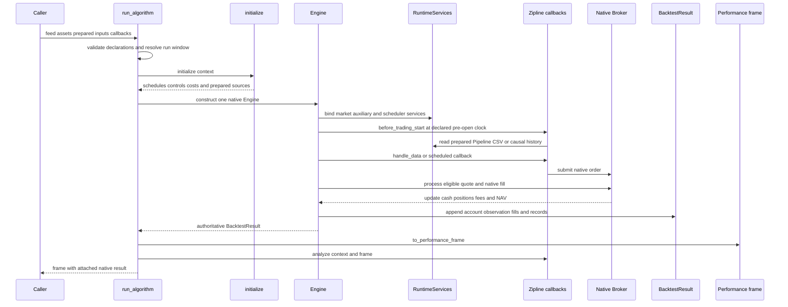

# Zipline Compatibility and Offline Migration

The Zipline compatibility layer is a migration facade, not a second simulator. It preserves selected Zipline callback and Pandas container conventions while `run_algorithm` constructs the normal `Engine`, submits orders to its native `Broker`, and projects the resulting `BacktestResult` into a familiar performance frame. Portfolio, position, order, fill, cash, and NAV views are therefore backed by the same authoritative broker ledger used by native strategies.

The boundary is deliberately offline and explicit. The caller supplies a `DataFeed`, declared `Asset` objects or a `PreparedAssetLookup`, and any prepared benchmark, CSV, Pipeline, history, or continuous-futures inputs. The adapter does not discover a Zipline bundle, download a default benchmark, fetch callback-time CSV data, rewrite imports, or require Zipline at execution time. For the broader data-to-analysis workflow, see the repository's [offline migration guide](../../docs/user-guide/offline-migration.md); for native runtime ownership and phases, see [Event-Driven Runtime](../architecture/event-driven-runtime.md) and [Runtime Services](../architecture/runtime-services.md).

## Entry points and ownership model

Import migration entry points from `ml4t.backtest.compat.zipline`:

- `run_algorithm` runs imported callbacks on explicit native inputs.
- `to_performance_frame` projects an in-memory or reloaded native result without rerunning decisions.
- `PreparedAssetLookup`, `PreparedPipeline`, `PreparedCSV`, `ContinuousFuture`, and `PreparedFutures` describe explicit migration inputs.
- Zipline-style order, scheduling, control, recording, and lookup functions live in `ml4t.backtest.compat.zipline.api`; finance model and execution-style names live under `ml4t.backtest.compat.zipline.finance`.

A minimal callback migration changes imports and supplies the feed and asset mapping:

```python
from ml4t.backtest.compat.zipline import run_algorithm
from ml4t.backtest.compat.zipline.api import order, symbol
from ml4t.backtest.compat.zipline.assets import Asset


def initialize(context):
    context.asset = symbol("ALPHA")


def handle_data(context, data):
    order(context.asset, 10)


performance = run_algorithm(
    feed=prepared_feed,
    assets=[Asset("A", symbol="ALPHA", legacy_sid=17)],
    initialize=initialize,
    handle_data=handle_data,
)
native_result = performance.attrs["backtest_result"]
```

`MigrationContext` permits user state such as `context.asset`, but its account-facing properties are live projections. `context.portfolio`, `context.account`, positions, order inspection, cancellation, and all order helpers delegate to the native broker. Stable native asset keys remain authoritative; symbols and optional legacy SIDs are display and lookup metadata and cannot alias two native assets.

## Lifecycle and control flow

`run_algorithm` validates asset declarations, creates migration defaults and a `RuntimeServices` instance, resolves physical or session run bounds, then invokes `initialize` inside a scoped compatibility API context. Initialization may register costs, controls, schedules, prepared Pipeline/CSV inputs, benchmark selection, and cancellation policy. Those declarations are compiled into native configuration, execution limits, commission/slippage models, scheduler registrations, and auxiliary sources before `Engine.run()`.



*The adapter scopes familiar callbacks and presentation around one native runtime, broker, and result.*

During native `on_start`, the callback strategy binds the broker, registers trading and account controls, and installs pre-open and scheduled callbacks. `before_trading_start` runs through the native scheduler. `handle_data` runs at accepted market events; scheduled callbacks run only at compiled, observed instants. Orders then follow native trigger, next-bar eligibility, fill ordering, volume, slippage, fee, and account rules. When execution finishes, the adapter builds the performance frame, calls `analyze(context, performance)` if supplied, and returns that frame. `analyze` is presentation-time only: account mutation, cancellation, and late model reconfiguration are not allowed.

Run state is scoped. Migration order IDs include a per-run prefix, scheduler registrations are owned by the bound runtime and cleaned up after success or failure, and a retained ID from one run cannot address a later run's local native order. Create a fresh `Engine` run for a new scenario.

## Data reads and identity

`BarData` presents Zipline-like Pandas shapes over the runtime's causal market service:

| Selection | `current` | `history` |
|---|---|---|
| one asset, one field | scalar | `Series` |
| one asset, multiple fields | named `Series` | MultiIndex `DataFrame` |
| multiple assets, one field | asset-indexed `Series` | asset-column `DataFrame` |
| multiple assets, multiple fields | asset-row `DataFrame` | MultiIndex `DataFrame` |

The implementation preserves observed Zipline 3.2 details rather than only its prose: multi-field history uses index names `date`/`date_time` and an unnamed asset level, numeric history is `float64`, daily calendar labels are naive session dates, and minute or calendar-free labels are UTC nanosecond instants. Reads remain causal. Pre-open access cannot see a future daily close, insufficient warmup coverage raises, and requested `1d` or `1m` history must match an explicitly prepared source grid except for the adapter's declared minute-to-session aggregation path. Cross-frequency preparation otherwise belongs upstream.

`data.can_trade` combines known-price eligibility, native instrument lifetimes, and compiled restriction predicates; it is not a promise of a fill or buying power. `data.is_stale`, `last_traded`, and current-price behavior use the adapter's declared read policy, while execution quotes remain raw observed market facts. Research CSV fields cannot replace market OHLCV, even if a field is named `close`.

For bundle-derived identity, export once in a preparation environment and consume the portable snapshot through `PreparedAssetLookup`. Dated and country-specific symbol selection uses captured ownership facts. Selecting an identity does not manufacture a quote, establish tradability, or infer historical publication time; causal instrument eligibility still belongs to a Data-backed runtime service.

## Orders, costs, and controls

The callback API exposes quantity, value, percent, and target variants: `order`, `order_value`, `order_percent`, `order_target`, `order_target_value`, and `order_target_percent`. They perform scalar sizing and submit native orders. Value sizing uses the last observed price and contract multiplier; target sizing subtracts the held quantity but intentionally ignores pending orders. Repeating a target can therefore create multiple orders, and admission does not guarantee affordability.

Market, limit, stop, and stop-limit styles compile to native trigger state. Native next-bar timing, partial fills, shared observed-volume limits, slipped-price limit checks, and cancellation remain in force. `get_order` and `get_open_orders` return detached compatibility views; `cancel_order` delegates to the broker. Projected transactions retain both a scoped migration `order_id` and the underlying `native_order_id`, while the attached native fill table remains authoritative.

Adapter defaults are migration-specific and do not alter native Engine defaults. The callback runner selects next-bar close execution, integer-style migration rounding, FIFO, shorting and leverage, per-share equity commission, five-basis-point equity slippage, and a shared 10% asset/bar volume cap. Positive observed volume is still required, including with `NoSlippage`. Explicit commission and slippage declarations compile into native models and limits.

Trading controls (`set_max_order_size`, `set_max_position_size`, `set_max_order_count`, long-only rules, and asset restrictions) compile into native pre-submission validators; they do not create a compatibility order book. `on_error="fail"` raises `TradingControlViolation` before submission. `on_error="log"` logs and allows submission, matching the supported reference convention. The Zipline-compatible request-count model counts requests that reach it—including zero-sized requests or requests rejected by a later rule—so rule order is observable.

Leverage controls compile into native account controls evaluated at session close. They require a declared calendar and an observation at every relevant actual close; missing close observations fail rather than silently skipping validation. A violation reports the native account state and does not reverse fills or liquidate positions.

## Scheduling conventions

`schedule_function` is setup-only and supports `every_day`, week start/end, and month start/end date rules. Offset selection is based on the full calendar period, including sessions before feed start. `half_days=False` excludes early-close sessions rather than moving the callback.

For daily data, the time rule is ignored: selected callbacks run at the one observed daily event, after `handle_data`, in registration order, before account observation. For minute data, inputs must be explicitly right-labelled. Open and close offsets target real observed minutes; missing endpoints create neither bars nor callbacks. Default or `every_minute()` scheduling uses the first observed regular minute once per selected session, while `handle_data` still runs for every event.

`before_trading_start` is registered at the native pre-open phase, normally 45 minutes before the declared session open. Orders are forbidden there. A declared calendar is mandatory; `calendar=None` rejects session callbacks instead of assuming NYSE. One intentional divergence is early-close daily behavior: the adapter executes once per selected session, correcting a published Zipline `OncePerDay` elapsed-time artifact that could omit the earlier close.

## Prepared Pipeline and CSV delivery

`PreparedPipeline` is a delivery adapter, not a Pipeline expression engine. Engineer (or another explicit preparation step) calculates factors, screens, lookbacks, decision instants, publication clocks, and eligibility before simulation. At each `before_trading_start`, the native auxiliary service captures only rows known and eligible at that exact decision instant. Eager and lazy modes differ only in when Pandas conversion occurs; both capture the same pre-open snapshot, and returned frames are independent copies.

The original Pipeline DSL, arbitrary custom terms, and `chunks` calculation scheduling are unsupported. `attach_pipeline` rejects a legacy Pipeline object and non-`None` `chunks`. Missing declared decisions raise instead of reusing yesterday's factors; a declared empty decision returns an empty frame with declared columns and dtypes; unmapped eligible asset keys also fail explicitly.

`PreparedCSV` similarly moves I/O and transformation out of callbacks. The caller loads bytes into a Pandas frame, optionally applies `pre_func` before date and symbol mapping and `post_func` after conversion to a UTC index, and declares a separate `available_at_col`. The prepared content becomes frozen native `AuxiliaryData`. During `initialize`, `fetch_csv(original_source_id)` only activates a registered identity; it performs no network access, and an unknown identity raises.

CSV observation dates are physical instants in the declared timezone, not implicitly rolled sessions. Publication remains separate and causal: unknown publication is unavailable, and a value published even one nanosecond after a decision cannot enter that decision. Duplicate observation/asset keys, conflicting sources, ambiguous symbols, and reserved-key collisions require explicit upstream resolution.

## Futures adaptation

Dated `Future` assets carry explicit root, multiplier, and tick size. `future_symbol` resolves only declared contracts. `ContinuousFuture` is a non-tradable research key: orders must target the actual dated `Future` selected by `data.current(handle, "contract")`. `PreparedFutures` asks a causal Data provider for the front contract and chain at the exact `as_of` cutoff, verifies publication and decision clocks, validates roll policy and normalized units, and applies the legacy offset by dated maturity rather than volume rank.

Continuous adjusted history is registered separately as an explicit history source. The adapter does not infer a chain, discover a bundle, or turn a synthetic continuous series into an executable contract. Futures commissions compile to native per-contract or per-order models. Multiplier affects sizing and P&L, not the per-contract fee.

Cash accounting is also explicit. Migrated futures that require mark-to-market variation must declare `ContractSpec(accounting_method="futures_variation", settlement_policy="on_mark")`; margin configuration alone does not select that method. Continuous roots without a dated chain and roll map remain outside the supported comparison boundary.

## Results and analysis

`to_performance_frame(result)` reads native account observations and produces UTC-indexed Pandas columns for `portfolio_value`, `cash`, `positions_value`, period `returns`, actual grouped `transactions`, and recorded variables. Benchmark columns appear only when explicit `BenchmarkData` is present. Rows preserve native observation frequency; minute results are not aggregated into Zipline daily packets, and missing positions or statistics are not reconstructed.

A recorded name that collides with a native account column raises. The native result is attached at `performance.attrs["backtest_result"]`, preserving fills, holdings, account states, configuration, benchmark provenance, input provenance, and serializable artifacts. Reloaded migration artifacts retain declared asset mappings and scoped order metadata; ordinary native results require an explicit mapping when display symbols or legacy SIDs matter.

For trustworthy comparisons, inspect ordered submissions and fills, quantities, prices, fees, cash, NAV, exposure, and intermediate decisions—not only final return. Keep original Zipline version, bundle ingestion identity, calendar, asset lifetimes, adjustment basis, costs, and timestamp semantics with the reference output. The compatibility tests cover callback ledger behavior, Pandas read shapes, request-count controls, prepared Pipeline causality, and the complete offline snapshot-to-analysis route; they establish those declared workloads, not universal parity.

## Intentional boundaries and failure policy

Unsupported behavior fails at setup or at the first invalid lifecycle point rather than silently guessing:

- No bundle ingestion, implicit symbol database, default SPY download, callback network I/O, import rewriting, or second execution ledger.
- No legacy Pipeline calculation engine; factors and universes must be prepared with explicit decision and publication clocks.
- No arbitrary cross-frequency history inference, synthetic missing bars, implicit corporate actions, or inferred futures chains and accounting.
- Setup-only APIs—cost models, controls, schedules, Pipeline/CSV attachment, benchmark choice, and cancel policy—must run during `initialize`; `pipeline_output` is unavailable until a completed pre-open capture.
- Session scheduling and session-end controls require a declared calendar and required observations. Conflicting run bounds, duplicate mappings, unknown sources, unsupported frequencies, insufficient warmup, and ambiguous identities raise explicit errors.

These boundaries are the migration contract: prepare source facts offline, declare semantics at the boundary, let one native Engine and broker own execution, and treat the compatibility frame as a projection of—not an alternative to—the native result. Configuration and profile comparisons remain workload-specific; see [Configuration and Profiles](../concepts/configuration-and-profiles.md) and [Quality, Parity, and Release](../testing/quality-parity-and-release.md).
