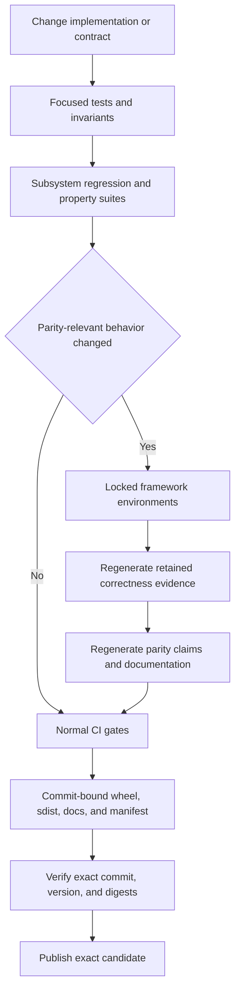

# Testing, Parity Evidence, and Release Qualification

Quality assurance has three deliberately different layers:

1. **Fast development feedback** checks the changed behavior with focused unit, property, oracle, regression, and contract tests.
2. **Comparison validation** runs ML4T and external frameworks under behavior-matched profiles, usually in optional or isolated environments.
3. **Release qualification** retains provenance-bearing evidence, executes all required gates for one exact commit, and publishes the already-qualified artifacts rather than rebuilding them.

Do not turn every local edit into a full cross-framework run. Conversely, a green focused test run is not a substitute for fresh parity evidence when execution behavior, a compatibility profile, or the comparison protocol changed.



*The qualification path becomes broader only when a change crosses from local behavior into parity or release evidence.*

## Start with the smallest meaningful test

A useful local progression is:

```bash
# One behavior or regression
uv run pytest tests/test_partial_close_accounting.py -q

# One subsystem
uv run pytest tests/accounting tests/execution -q

# Property, independent-oracle, and regression coverage
uv run pytest tests/property tests/test_oracle_differential.py tests/regression -q

# Fast broad selection; exclude timing-sensitive and explicitly slow work
uv run pytest tests -m "not benchmark and not slow" -q
```

Pytest discovers `tests/test_*.py`, `Test*`, and `test_*`. The configured markers are `unit`, `integration`, `slow`, `benchmark`, `private`, `requires_comparison`, and `no_invariant_check`. Marker spelling is enforced with `--strict-markers`, so an unregistered marker is an error rather than a silent selection mistake. The default configuration also ignores `tests/private` and `tests/validation`; optional comparison work should not leak into the ordinary suite.

Choose tests according to the changed contract:

- **Focused unit and subsystem tests** belong next to accounting, execution, futures, risk, result projection, calendar, runtime, and Zipline compatibility behavior. A broker or fill-ordering edit should normally exercise both the narrow module and its end-to-end `Engine.run()` path.
- **Property tests** use Hypothesis to range over prices, quantities, order sequences, and order types. They are valuable when the requirement is algebraic—cash reconciliation, P&L decomposition, or legal fill bounds—rather than one expected example.
- **Independent oracle tests** compare the system under test with a pure-Python reference that imports no `ml4t.backtest` code. Its deliberately narrow market-order model independently checks long/short P&L, fees, slippage, timing, and final cash, reducing the risk that test and implementation share the same bug.
- **Regression tests** use deterministic synthetic strategies to detect changes in execution outcomes and repeatability. Review any expected-output update as a behavior change; do not refresh it merely to make a failure disappear.
- **Contract tests** protect public API shape, profile behavior, ledger ownership, execution contracts, validation schemas, documentation, coverage policy, workflows, packaging, security, and evidence generation. Run the relevant contract file whenever changing validation code or CI, even if runtime code is untouched.

See [Configuration and Profiles](../concepts/configuration-and-profiles.md) when a test selects a preset, and [Zipline Compatibility](../integrations/zipline-compatibility.md) for adapter-specific behavior.

## The always-on accounting safety net

The root [`tests/conftest.py`](../../tests/conftest.py) defines an autouse fixture that monkeypatches `Engine.run` for every test. The wrapper:

1. calls the original run,
2. derives initial cash from `self.config.initial_cash` (falling back to `100_000.0` if no config is present),
3. calls `assert_result_invariants(result, initial_cash)`, and
4. returns the checked result.

This makes every engine-exercising test an accounting-invariant test without requiring each test author to remember an assertion. The invariant helper checks terminal-equity reconciliation (including open and realized P&L, funding, external flows, and corporate-action effects), gross P&L minus fees, direction signs, MFE/MAE bounds, non-negative costs and positive multipliers, fill timestamp ordering, finite trade fields, exit-reason consistency, limit/stop fill bounds, and allocation of fill commissions to trades or corporate-action records. Its accounting tolerance is scaled from floating-point ULPs and operation count rather than a broad fixed dollar allowance.

Use `@pytest.mark.no_invariant_check` only when the automatic wrapper would invalidate the purpose of the test—for example, a test that invokes the invariant helper explicitly or intentionally constructs an intermediate/non-universal result. The marker opts out of the whole autouse check, so the test must assert the intended replacement contract itself. It is not an escape hatch for an unexplained reconciliation failure.

## Warnings and coverage are failures, not background noise

The warning policy starts with `error`. Only narrow, message- and module-specific exceptions are allowed for known upstream NumPy, pandas/calendar, VectorBT, and Zipline warnings. New warnings therefore fail tests. Fix the caller, upgrade the dependency, or add a tightly scoped suppression with an explanation; never add a global `DeprecationWarning` or `PendingDeprecationWarning` ignore.

The release coverage job runs the suite with branch coverage and excludes benchmark tests. The checker requires at least 87% global statement coverage and 76% global branch coverage, plus higher per-file floors for critical accounting, broker, configuration, execution, order, risk, data-feed, engine, result, and type modules. This checker is stricter and more targeted than the generic 84% coverage.py floor in `pyproject.toml`.

## Keep ordinary tests separate from comparison environments

The `comparison` extra is optional and constrained by external framework compatibility. It is useful for selected in-process contracts on supported Python versions:

```bash
uv sync --dev --locked --extra comparison --extra viz
ML4T_COMPARISON_INPROC=1 uv run --no-sync pytest -q --no-cov \
  tests/contracts/test_cross_engine_contracts.py
```

That shared environment is not the authoritative parity environment. Current framework targets have incompatible dependency requirements, so release parity builds each target from its committed lock under `validation/environments/`. Build them with:

```bash
python validation/build_framework_env.py --all-public
python validation/build_framework_env.py --framework lean
# Requires licensed source access:
python validation/build_framework_env.py --framework vectorbt_pro
```

For diagnostics in an already suitable environment, `validation/run_scenario.py` can run one scenario or one framework. A missing required framework still produces a nonzero result; an explicitly unsupported pair remains visible and is not counted as a pass.

```bash
python validation/run_scenario.py --scenario 01 --framework backtrader
python validation/run_scenario.py --framework vectorbt_oss
python validation/run_scenario.py --dry-run
```

## What parity evidence proves

Parity is profile-specific evidence, not a statement that every framework has one universal behavior. ML4T configures all relevant execution choices—timing, prices, stops, cash constraints, fill order, sizing, commissions, slippage, and rebalance semantics—to match the selected external framework. A meaningful comparison is therefore `ml4t[backtrader_strict]` against Backtrader, not ML4T's `default` profile against Backtrader.

The retained evidence has distinct scopes:

- The **real-strategy audit** uses frozen market data and model-derived targets. It is the primary applicability evidence.
- The **synthetic scenario matrix** isolates execution conventions and compares ordered fills, closed trades, and terminal state after canonical quantization.
- The **large-scale synthetic workload** stresses event counts and state transitions; it does not by itself establish realistic-strategy equivalence.
- **Native behavior probes** establish what the pinned external implementation does, independently of ML4T's adapter.

Release comparisons require equality in the declared canonical domain: nonmonetary values are fixed-point records, while monetary account values must round to the same cent using round-half-even. Diagnostic thresholds may explain a mismatch but do not turn it into a pass. Unsupported capability pairs must be declared; unavailable, skipped, timed-out, malformed, duplicate, or missing required work fails qualification.

The authoritative isolated runner is:

```bash
# Full required matrix; eligible to promote accepted evidence
python validation/run_all_correctness.py

# Diagnostic subset; never promotes the complete retained matrix
python validation/run_all_correctness.py \
  --framework backtrader --scenarios 01,03,05,09
```

Every run writes a candidate. Only a complete passing matrix can replace `validation/CORRECTNESS_RESULTS.json`. Records retain framework and ML4T outputs, canonical comparison details, input and source digests, runtime identity, adapter identity, framework pin, capabilities, and record counts.

## When evidence must be regenerated

Regenerate affected parity evidence when a change can alter either side of the claim or the protocol used to judge it. This includes:

- a profile value, profile default, or new `BacktestConfig` execution dimension;
- engine, broker, accounting, sizing, order lifecycle, risk, fill, valuation, or result-projection behavior;
- a validation adapter, canonical-record serializer, comparator, capability declaration, scenario, generated input, or applicability map;
- a pinned framework target, lock, immutable source identity, or comparison dependency;
- the fields or precision named by a documented parity claim.

The scenario evidence hashes the ML4T engine tree, `profiles.py` plus scenario overrides, adapter, comparator, capabilities, runner, scenario, inputs, and framework manifest. The real-strategy evidence separately rejects a stale engine-tree digest, applicability digest, adapter/comparator digest, framework target, or dirty source tree. After producing accepted evidence, run the parity-claim generator rather than editing generated result tables by hand:

```bash
uv run python validation/generate_parity_claims.py --check
```

A result from an old branch head cannot qualify changed code merely because its headline numbers still look equal. It measured different source, and the retained provenance is designed to expose that distinction. Release qualification also binds the candidate manifest, documentation artifact, wheel, and source distribution to the requested full commit SHA; preflight requires that SHA to equal the workflow checkout and current `origin/main`. Qualifying old-head artifacts would therefore test one program and publish another.

Performance evidence has one deliberate exception to unnecessary reruns: unchanged timings may be retained after a documented review concludes that a change cannot materially affect the timed path. The certification must bind the new engine source and current correctness evidence. Material or uncertain timing changes require new measurements; matching output alone is not a timing-impact review.

## Performance qualification

There are two complementary checks:

- The instrument-free hot-path benchmark runs with `--no-cov`, interleaves seven optimized and legacy measurements, and fails if the median optimized/legacy runtime ratio exceeds `1.10`. Coverage instrumentation is explicitly excluded because it distorts this comparison.
- `validation/performance_baseline.py` runs deterministic workloads in child processes, times only `Engine.run`, records process peak RSS, and verifies behavior checksums, fill/trade counts, data points, and final value. It requires at least three release samples. Runtime and memory spread relative to the median are reported; the artifact's pass/fail decision is based on behavioral stability, while the hot-path test supplies the runtime regression threshold.

Run the two checks with the same boundaries used by CI:

```bash
uv run pytest \
  tests/benchmark/test_hotpath_benchmarks.py::test_optimized_feed_runtime_vs_legacy_baseline \
  -v --tb=short --no-cov

uv run python validation/performance_baseline.py \
  --manifest validation/performance_baselines.json \
  --output release-performance-evidence.json \
  --samples 3
```

For retained cross-framework or real-strategy performance, preserve raw samples, warm-up policy, timing boundaries, environment, checksums, and correctness references. See [Results Analytics and Artifacts](../workflows/results-analytics-and-artifacts.md) for interpreting generated outputs.

## Documentation and package checks

Documentation is executable release surface. CI builds MkDocs in strict mode, checks rendered links and page identity, and retains a commit-named immutable site artifact. Package qualification then:

- builds wheel and sdist twice and compares reproducibility and contents;
- validates metadata and long description;
- installs the candidate wheel into a clean environment;
- executes documented quick starts and optional diagnostic handoff examples against that wheel;
- checks pinned book links and confirms the checkout is unchanged.

When changing a public example, run the relevant checker rather than assuming syntax highlighting implies executability:

```bash
uv run python validation/check_documentation_examples.py
uv run python validation/check_book_links.py
uv run mkdocs build --strict
```

The user-facing starting flow is documented in [Quickstart](../quickstart.md).

## Release gates and artifact lifecycle

CI separates lint, type checking, compatibility, security, branch coverage, runtime/performance, public parity, documentation, and packaging. The candidate manifest accepts exactly these ten successful gate names: `compatibility`, `correctness`, `coverage`, `documentation`, `lint`, `packaging`, `parity`, `performance`, `security`, and `typecheck`. It also requires exactly one wheel and one source distribution with one package identity and records each file's size and SHA-256 digest.

Release adds ecosystem qualification plus licensed VectorBT Pro and pinned LEAN comparisons. Preflight rejects a candidate unless the requested stable version is unpublished and the full candidate SHA is simultaneously the workflow commit, checkout commit, and current `origin/main`. The release then downloads—not rebuilds—the documentation and distribution artifacts named for that SHA, verifies version/source/tag/digests, deploys the immutable docs, publishes the exact distributions, verifies PyPI digests, creates the tag at the qualified commit, and exercises the installed published wheel.

This ordering is the central release invariant: **test, document, and publish the same bits from the same commit**. A failure after publication is recovery work; it is not permission to silently substitute a new build under the same version.

## Change checklist

1. Identify the observable contract and add or update the narrowest test first.
2. Exercise `Engine.run()` so the autouse accounting checks cover the result; justify any `no_invariant_check` marker locally.
3. Run affected property, oracle, regression, and contract suites.
4. Treat every new warning as a failure and preserve strict marker registration.
5. Decide explicitly whether execution semantics, a profile, or comparison infrastructure changed.
6. If yes, rebuild the relevant locked environment, regenerate complete evidence, and regenerate parity claims and documentation.
7. Run benchmarks without coverage when the timed path may have changed; retain or recertify performance evidence only under the documented policy.
8. Validate executable documentation and the built wheel, not only the source checkout.
9. Release only the manifest-bound candidate for the current `origin/main` commit.
