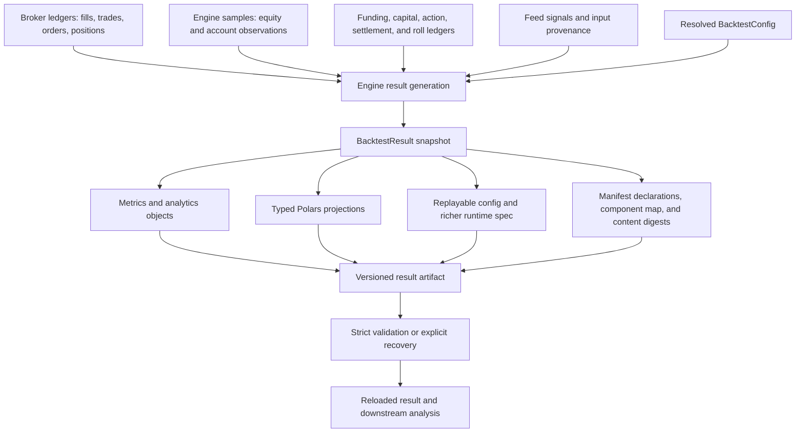

# Results, Analytics, and Reproducible Artifacts

`Engine.run()` finishes by projecting engine, broker, feed, and accounting state into a `BacktestResult`. The result is both an in-memory analysis boundary and the owner of the persisted artifact contract. It does not merely serialize a metrics dictionary: it retains execution evidence, account observations, optional input and lifecycle evidence, and enough declarations to validate richer ledgers on reload.

The result is a snapshot. Trades, fills, rejected orders, equity observations, portfolio observations, funding payments, capital changes, and the resolved config are copied when the run completes; later mutation of the engine or broker does not extend the completed result. For execution and accounting semantics before this boundary, see [Broker Execution and Accounting](../architecture/broker-execution-and-accounting.md). Corporate actions, funding, settlement, and cash lifecycle interpretation are covered in [Instrument and Cash Lifecycles](../concepts/instrument-and-cash-lifecycles.md).

## End-to-end projection



*Completed runtime state is projected into analysis views and a manifest-governed artifact, then validated before downstream use.*

`Engine._generate_results()` adds end-of-backtest open positions as mark-to-market trades with `status="open"`; realized analytics use only `"closed"` and `"partial"` records. The result's raw `trades` list therefore answers a different question from `metrics["num_trades"]`: the former includes open marks, while the latter counts realized exit legs. The engine also attaches `EquityCurve` and `TradeAnalyzer` for a live result. A reloaded artifact reconstructs the raw data and metrics but does not recreate those optional analytics objects; use the stable DataFrame and metric surfaces for persistence-sensitive consumers.

## Result surfaces and availability

The core constructor fields and the default engine result include:

- `trades`, including closed and partial realized legs plus open end marks;
- `fills`, preserving order identity, sequence, execution price and costs, conditional-order fields, price source, quote context, and exit reasons;
- `equity_curve` and `portfolio_state` account observations;
- `rejected_orders`, funding payments, metrics, initial capital, the resolved `BacktestConfig`, and account-method declarations;
- `equity` and `trade_analyzer` analytics objects for a non-empty engine run.

Stable projections return typed empty frames when the corresponding always-defined collection is empty. Important methods are `to_trades_dataframe()`, `to_fills_dataframe()`, `to_funding_dataframe()`, `to_rejected_orders_dataframe()`, `to_equity_dataframe()`, `to_portfolio_state_dataframe()`, `to_capital_flows_dataframe()`, and `to_daily_pnl()`. `to_dict()` and dict-like access (`result[key]`, `get`, `keys`, `items`) preserve compatibility with older consumers by merging metrics with raw result components.

Some surfaces are genuinely optional, not synonymous with an empty observation:

| Surface | Availability and meaning |
| --- | --- |
| Predictions | `to_predictions_dataframe()` returns an empty frame if no raw feed signals were supplied. When present, these are the original model/input rows, not a reconstructed post-mapping signal. |
| Holdings | Requires capture such as `holdings_sampling="bar"`, `"session"`, or `"fill_and_session"`. `to_holdings_dataframe()` raises `ArtifactError` if capture was disabled. An available but empty table means a completely observed all-cash book. |
| Recorded strategy variables | Exists only if `broker.record(...)` was used. `to_recorded_dataframe()` raises when unavailable; records are bar-end samples encoded as portable tagged JSON. |
| Prepared benchmark | `to_benchmark_dataframe()` raises if absent and verifies that benchmark periods exactly match the equity observation grid. |
| Corporate actions and entitlements | Available only when the action ledger was captured; application and earned-entitlement tables remain separate. |
| Futures settlements and rolls | Available only when their runtime ledgers were captured. Roll rows record actual close/open outcomes and do not claim atomic paired execution. |
| `config.yaml` and `spec.yaml` | Both require an attached runtime config. Explicitly requesting either without one is a write error. |

Portfolio observations receive a monotonic `observation_id`. Metadata distinguishes ordinary `bar`, `after_fill`, and `session_last_observed` rows; `holdings_complete` says whether the holdings rows for that key are a complete snapshot, and an `after_fill` observation points to its zero-based `fill_sequence`. This prevents “no holdings rows” from being misread as a flat portfolio. Complete holdings must contain exactly `open_positions` rows for that observation.

## Equity, returns, and risk metrics

`to_equity_dataframe()` sorts observations and derives `return`, `cumulative_return`, `drawdown`, `high_water_mark`, and `performance_equity`. Recorded `initial_capital` is the baseline before the first observed NAV, so first-period fees and losses are visible rather than erased. With external capital changes, returns are flow-adjusted and `performance_equity` compounds investment performance at the initial-capital scale; raw `equity` remains account NAV. Drawdown is calculated from performance wealth, so contributions and withdrawals do not masquerade as gains or losses.

`EquityCurve` provides total return, CAGR, volatility, Sharpe, Sortino, Calmar inputs, and drawdown. Its annualization prefers configured cadence; observation-based feeds and elapsed-time inference have explicit fallbacks. `to_returns_series()` is bar/observation-level. `to_daily_returns()` resolves the feed calendar unless the caller explicitly passes `calendar=None`; daily/session aggregation should be used with a matching annualization factor. `to_daily_pnl(session_aligned=True)` uses configured session boundaries when a calendar is available; otherwise daily P&L uses calendar dates.

The engine's metrics combine:

- investment performance and risk (`total_return`, CAGR, volatility, drawdown, Sharpe, Sortino, Calmar);
- realized-leg statistics (wins, losses, expectancy, payoff and profit factors);
- execution activity (orders, fills, rejected orders, rebalance timestamps, filled notional, turnover, symbols, and position occupancy);
- costs, funding, and external-flow totals;
- lifecycle/execution policy counts and, when configured, retained invocation and intent histories.

`TradeAnalyzer` deliberately separates realized-leg and lifecycle statistics. P&L statistics include partial reductions. Holding duration and MAE/MFE statistics use only full closes; if realized legs exist but no lifecycle has closed, those lifecycle values are `NaN`, not a misleading zero.

## Gross-to-net cost traceability

Cost attribution can be followed from execution to aggregate metrics:

1. Each fill retains `commission`, per-unit `slippage`, execution and reference prices, quote context, and `fill_sequence`.
2. Each trade reports `gross_pnl` from the price move, net `pnl`, fees, entry and exit slippage, `total_slippage_cost`, `net_return`, and `cost_drag`.
3. `TradeAnalyzer` aggregates `total_gross_pnl`, fees, slippage, total costs, average drag, gross profit factor, and net profit factor.
4. Engine metrics use fill commissions so costs on still-open positions are included; slippage totals use all trade records, including open marks.

This split matters operationally: gross profit factor tests whether the price-move strategy has edge before execution drag, while net profit factor measures realized profitability after recorded costs. Funding is a separate cash-flow ledger and is not silently folded into fills or trade costs. The manifest's nullable `returns_include_commissions` declaration makes the return convention explicit for current artifacts while preserving “unknown” for older artifacts.

## Config versus runtime spec

The two YAML components serve different purposes:

- `config.yaml` is `result.config.to_dict()`: the fully resolved, replayable `BacktestConfig` payload. It can be reconstructed with `BacktestConfig.from_dict()`; see [Configuration and Profiles](../concepts/configuration-and-profiles.md).
- `spec.yaml` is versioned separately (`version: 1`) and wraps that same replayable `config` with the library version, realized start/end window, initial capital, account and instrument accounting methods, return convention, lifecycle evidence, execution policy, and intent/reconciliation evidence.

Thus the config is the behavioral input needed to configure another run, while the richer spec describes what this particular runtime resolved and observed. Neither stores the strategy implementation, external model code, arbitrary runtime services, or every upstream data byte, so neither alone guarantees bit-for-bit replay. On load, `config.yaml` is preferred; a valid spec can restore its nested config when the config component is missing or unreadable in recovery mode.

When a feed originates from a verified `ml4t.data.snapshot`, input provenance strengthens the replay chain. The manifest retains source snapshot and manifest SHA-256 identities, selected table names, normalized Arrow IPC table hashes, Polars version, and a digest of the entire provenance receipt. Validation requires a price table, permits only the known input roles, and checks that identities agree with the retained source manifest. This proves input identity; it does not embed the source tables themselves.

## Writing an artifact

```python
written = result.to_parquet("results/run-001")
```

The directory uses canonical component names. Tabular components are Parquet; metrics are standards-compliant JSON; config and spec are YAML; `manifest.json` is always written and returned as `written["manifest"]`. Default compression is `zstd`; supported alternatives are `lz4`, `uncompressed`, `snappy`, `gzip`, and `brotli`.

Always-required components for a **complete result artifact** are `trades`, `fills`, `rejected_orders`, `equity`, `portfolio_state`, `daily_pnl`, and `metrics`. Additional components become required when the result declares captured funding, capital flows, holdings, recorded variables, a benchmark, actions, futures variation, or rolls. Optional unavailable components are skipped by the default export and explained in `manifest["omitted_components"]`. In contrast, an explicit `include=[...]` that names an unavailable component raises `ArtifactWriteError`. A selective export is valid as a component bundle, but its manifest has `complete: false` unless it satisfies the whole declared contract.

Before touching output files, the writer serializes text payloads and validates provenance and declared ledgers. It then:

1. creates `.artifact-incomplete` and removes any stale manifest;
2. writes selected components under canonical names;
3. writes `manifest.json` last with type, schema, library version, component map, omission reasons, declarations, and content digests;
4. removes `.artifact-incomplete` only after success.

An interrupted write therefore fails closed. A stale manifest cannot make a partially replaced directory appear complete.

### Schema versions and richer ledgers

The current reader accepts result artifact schemas **2 through 7**. The writer chooses the least version capable of describing the result:

| Schema | Added contract |
| --- | --- |
| 2 | Legacy supported baseline; may lack recorded initial valuation. |
| 3 | Current core result contract and explicit initial-capital baseline. |
| 4 | Prepared benchmark metadata and content digest. |
| 5 | Corporate-action and entitlement provenance, observed receivables, and digest. |
| 6 | Per-instrument futures accounting, margin observations, settlement ledger, and digest. |
| 7 | Futures roll ledger and content identity. |

A newer schema is selected only by the corresponding richer content, not merely by library version. Unknown versions always raise `UnsupportedArtifactVersionError`, including in recovery mode, because their semantics are undefined. Older readers should not be assumed to understand newer artifacts.

Integrity checks are domain-aware rather than just “file can be parsed.” Examples include:

- daily P&L must exactly equal recomputation from stored equity and flows;
- fill and capital-flow sequence fields must uniquely cover zero through `n - 1`;
- holdings keys, timestamps, numeric values, completeness, and fill references must reconcile with account observations;
- funding counts and totals must agree with metrics;
- benchmark period keys and return values must match its digest and equity periods;
- action identities, causal timestamps, entitlements/payments, receivables, and account NAV must reconcile;
- futures declarations, margin fields, available funds, settlement cash, instrument terms, and fill references must reconcile;
- roll, action, futures, benchmark, and input-provenance payloads must match manifest SHA-256 identities.

Metric serialization rejects unsupported objects and non-string mapping keys. Finite scalars and containers, datetimes, NumPy values/arrays, and Polars Series are supported. `NaN` and positive/negative infinity are encoded as tagged JSON objects and restored on load rather than emitted as non-standard JSON constants.

## Strict reload, failures, and recovery

```python
from ml4t.backtest.result import BacktestResult

loaded = BacktestResult.from_parquet("results/run-001")
```

Strict loading is the normal integrity boundary. The error taxonomy communicates the failure stage:

| Error | Meaning |
| --- | --- |
| `ArtifactNotFoundError` | Path is missing, not a directory, or is empty in strict mode. |
| `ArtifactManifestError` | Manifest is absent/malformed, has the wrong artifact type or component mapping, or contains invalid declarations/provenance. |
| `ArtifactIncompleteError` | Incomplete marker exists, manifest declares a selective export, or required components/files are absent. |
| `ArtifactReadError` | A declared component cannot be decoded or violates cross-component/domain invariants. |
| `ArtifactWriteError` | A requested component is unavailable, invalid, unserializable, or cannot be written. |
| `UnsupportedArtifactVersionError` | Manifest schema is outside the explicitly supported set. |

`recovery=True` is an explicit salvage mode for retained beta or damaged artifacts, not a way to certify them:

```python
loaded = BacktestResult.from_parquet("results/legacy-run", recovery=True)
for issue in loaded.artifact_diagnostics:
    print(issue.code, issue.component, issue.message)
```

Recovery may discover canonical files without a manifest, accept the legacy `signals.parquet` name as predictions, ignore unreadable optional/core components, and report each action through immutable `ArtifactDiagnostic(code, component, message)` records. Codes distinguish missing manifests, incomplete writes, missing files, invalid components, inconsistent derived data, and data that could not be verified. It can use `spec.yaml` to recover config. It does **not** infer unknown schema semantics, synthesize a missing benchmark or ledger, or bless a recovered result as complete. Some declared integrity-bound ledgers still fail if their required paired tables or digest checks are absent because silently dropping half a financial ledger would change meaning.

## Downstream analysis and export

Use DataFrames rather than private engine state for reproducible analysis:

```python
trades = result.to_trades_dataframe()
fills = result.to_fills_dataframe()
equity = result.to_equity_dataframe()
accounts = result.to_portfolio_state_dataframe()
```

`enrich_trades_with_signals()` performs backward as-of joins at entry and exit, optionally by asset. It aligns naive and timezone-aware join keys, preserves trade order, and prefixes joined columns with `entry_` and `exit_`. `to_trade_records()` returns dictionaries compatible with `ml4t.diagnostic` without making that package a hard dependency; the bridge includes gross/net cost fields and legacy time aliases. Portfolio analysis and tearsheets require the separately installed optional diagnostic package.

`BacktestExporter` delegates single-result writes and reloads to `BacktestResult`. `batch_export()` writes `run_0001`, `run_0002`, and so on plus `sweep_summary.parquet` and CSV, combining supplied parameters with selected metrics. It can skip individual artifacts when only a sweep summary is needed. JSON reports target CI/CD consumption, while Markdown reports provide a compact human comparison. Treat those reports and sweep summaries as derived indexes; the per-run manifest-governed artifact remains the auditable source.

## Safe extension points and focused checks

When adding a persisted surface, update the component registry, stable schema, writer, reader default, required-component logic, manifest declaration/version, and cross-component validator together. New optional data must preserve the distinction between unavailable and observed-empty. New financial ledgers should carry source identity and causal timing and should reconcile against actual account observations rather than only self-consistent rows. Schema evolution should be additive or accompanied by an explicit new version; never reinterpret an old version in place.

Tests that define this boundary include:

- [`tests/test_result.py`](../../tests/test_result.py) for DataFrame projections, resolved specs, round trips, selective/incomplete exports, error subclasses, tagged metrics, strict/recovery behavior, and derived daily-P&L checks;
- [`tests/test_observed_artifact_contract.py`](../../tests/test_observed_artifact_contract.py) for observed account, holdings, capital-flow, and recorded-variable contracts;
- [`tests/test_trade_cost_decomposition.py`](../../tests/test_trade_cost_decomposition.py) for gross/net cost fields and round trips;
- [`tests/test_artifact_spec.py`](../../tests/test_artifact_spec.py) for artifact/spec expectations;
- [`tests/test_export.py`](../../tests/test_export.py) for exporter delegation, sweep summaries, and reports.

<!-- openwiki: broken internal link [../../src/ml4t/backtest/analytics] file "../../src/ml4t/backtest/analytics" does not exist. Fix the href or restore the target, then delete this comment. -->
Primary implementation anchors are [`result.py`](../../src/ml4t/backtest/result.py), [`engine.py`](../../src/ml4t/backtest/engine.py), the [`analytics`](../../src/ml4t/backtest/analytics) package, and [`export.py`](../../src/ml4t/backtest/export.py). Release and compatibility changes should also follow [Quality, Parity, and Release](../testing/quality-parity-and-release.md).
